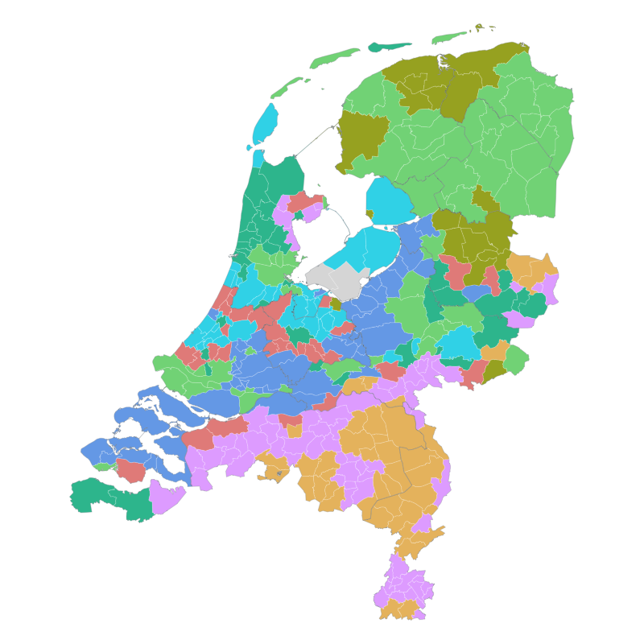
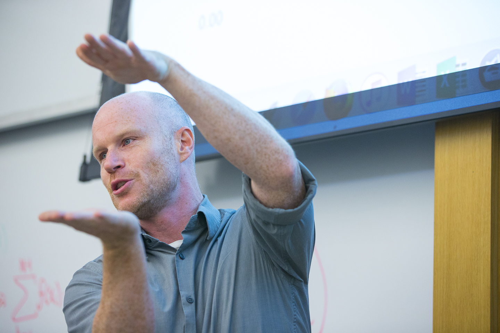

```{=html}
<div class="mast column-screen-inset">
  <p class="mast-name" role="heading" aria-level="1">Jack O'Brien</p>
  <p class="mast-sub">Applied statistics &middot; Bowdoin College</p>
</div>
<div class="hero-grid column-screen-inset">
  <div class="hero-viz">
    <div class="viz-pair">
      
      <video src="files/images/netherlands_1971_pca.mp4" poster="files/images/netherlands_1971_pca.png" autoplay muted loop playsinline preload="auto" aria-label="The same municipalities placed by how they voted in 1971, rotating in three dimensions"></video>
    </div>
    <p class="viz-caption">Dutch municipalities in 1971: on the map, and placed by how they voted, in the same eight voting blocs. <a href="research/worldwide.html">More on the Netherlands</a></p>
  </div>
  <div class="hero-text">
    <p>I'm an applied statistician and data scientist, and an associate professor of mathematics at Bowdoin College. My research is on how mixture models and similar approaches can be used to analyze social science data like <a href="https://royalsocietypublishing.org/rspb/article/283/1827/20152824/84418/Mixture-model-of-pottery-decorations-from-Lake">pottery sherds</a>, <a href="https://arxiv.org/abs/2301.01677">election results</a>, and <a href="https://journals.sagepub.com/doi/abs/10.1177/0038038520956940">tweets</a> to create remarkably simple portraits of complex social phenomena. I'm also fascinated by housing dynamics.</p>
    <div class="hero-links">
      <a href="mailto:jobrien@bowdoin.edu"><i class="bi bi-envelope"></i> Email</a>
      <a href="cv.html"><i class="bi bi-file-earmark-text"></i> CV</a>
      <a href="https://github.com/cascobayesian"><i class="bi bi-github"></i> GitHub</a>
      <a href="https://scholar.google.com/citations?user=eKEAQGUAAAAJ&hl=en"><i class="bi bi-mortarboard"></i> Scholar</a>
    </div>
  </div>
  
</div>
```
