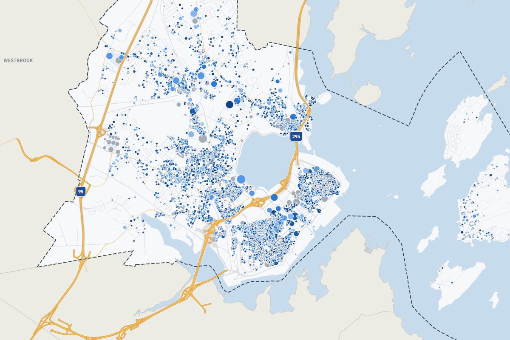
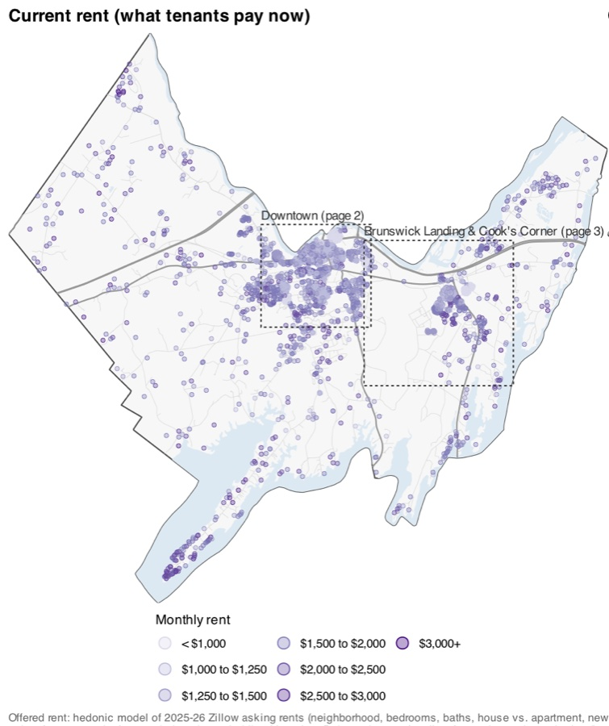

As we confront the disaster of increasing authoritarianism and its computational and data-based implementation, I think it is incumbent upon us as quantitative scholars that we challenge ourselves to do the difficult work of re-imagining our disciplines freed from their associations with the surveillance state. The [Just Mathematics Collective](https://www.justmathematicscollective.net/) provides some much needed initiative in that direction.

<!-- Outline from Jack's notes. Each section is a placeholder until written. -->

## Rent control in Portland

Portland's landlords report every unit's rent to the city each year. I mapped five years of those filings (2021–2025): 5,353 rental buildings and about 95,000 unit-year records, each placed on its tax parcel. Click a building to see every rent reported for it.

```{=html}
<a class="map-link" href="files/portland-rent-map/index.html" target="_blank" rel="noopener">
  
  <span class="map-link-label">Open the Portland rent registry map &rarr;</span>
</a>
```

## Brunswick rent registry

Brunswick has no rent registry, so I built one: the town's rental housing, unit by unit, from the assessor's records, with current rents estimated from Census data and asking rents from Zillow listings. The report covers housing units, rentals and short-term rentals.

```{=html}
<div class="map-link" style="pointer-events: none;">
  
</div>
```

## PMP

I am a huge fan of the [Prison Mathematics Project](https://prisonmathproject.org/). If you can, please consider joining or [donating](https://prisonmathproject.org/donate).
