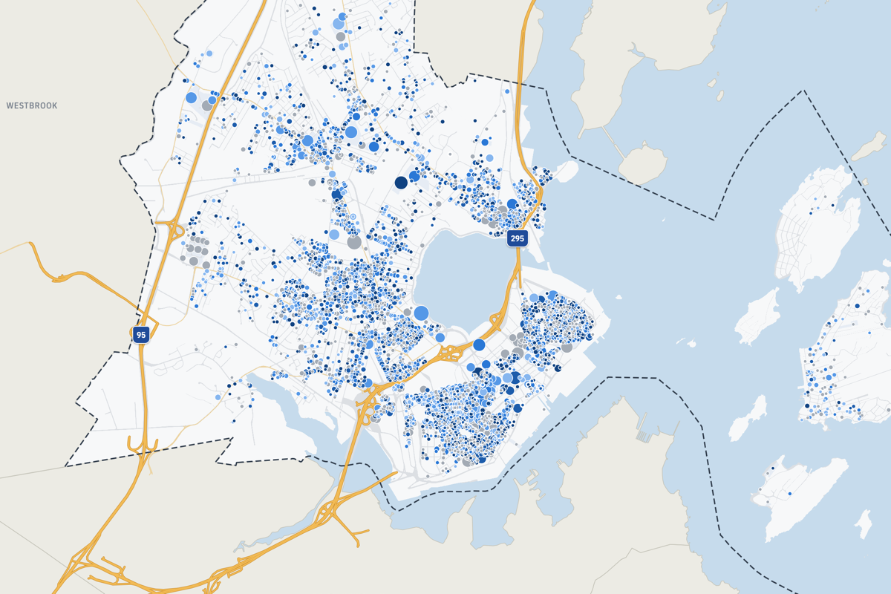
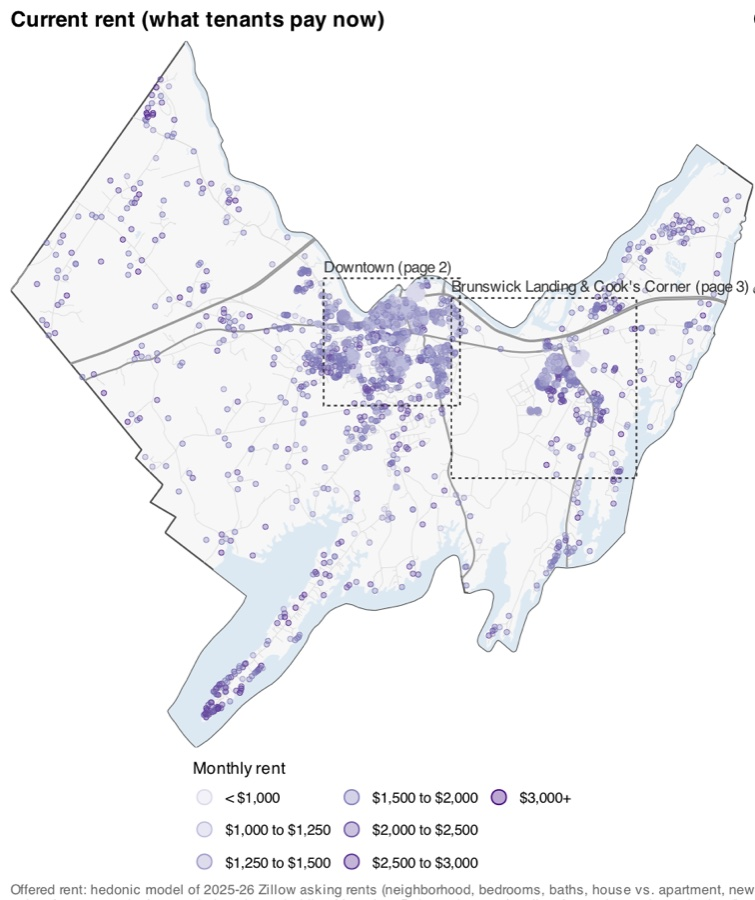
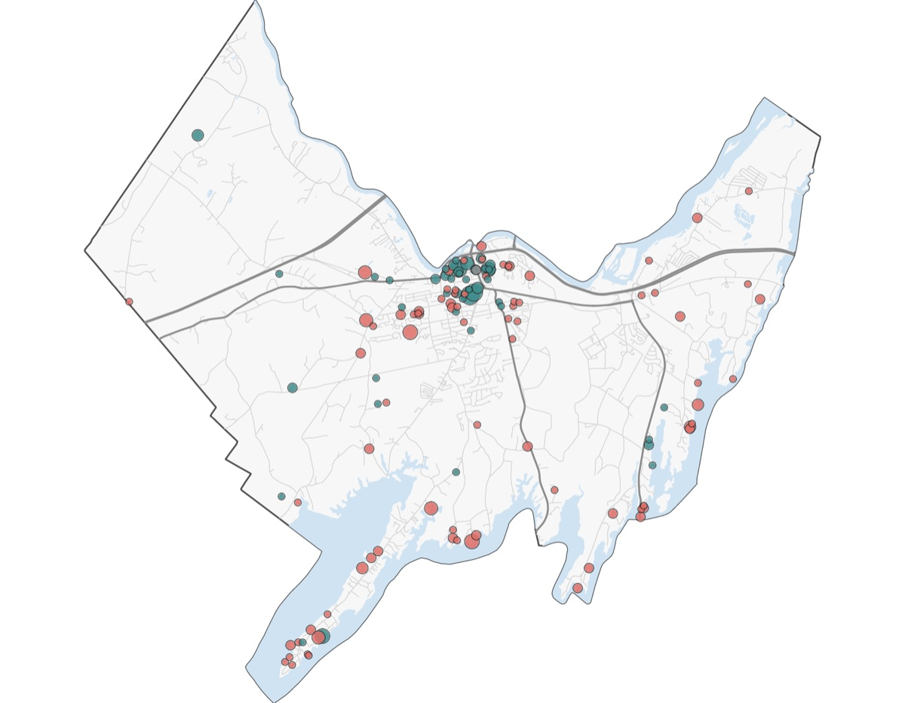

As we confront the disaster of increasing authoritarianism and its computational and data-based implementation, I think it is incumbent upon us as quantitative scholars that we challenge ourselves to do the difficult work of re-imagining our disciplines freed from their associations with the surveillance state. The [Just Mathematics Collective](https://www.justmathematicscollective.net/) provides some much needed initiative in that direction.

<!-- Outline from Jack's notes. Each section is a placeholder until written. -->

## Rent control in Portland

Portland, Maine's rent control ordinance specifies that all rental units in the city must be registered, recording the qualities of the units including rent. I mapped all of the filing from the start of the ordinance to most recent year (2021-2025), and produced two tools for renters: a [lookup tool](files/portland-rent-map/check.html) to see if their rent appears to be in compliance with the rent control ordinance; and a [map of all of the units in the city](files/portland-rent-map/index.html), including filters for short-term rentals, various levels of compliance, and other features.

```{=html}
<a class="map-link" href="files/portland-rent-map/index.html" target="_blank" rel="noopener">
  
  <span class="map-link-label">Open the Portland rent registry map &rarr;</span>
</a>
```

## Brunswick rent registry

Brunswick has no rent registry, so I built one: the town's rental housing, unit by unit, from the assessor's records, with current rents estimated from Census data and asking rents from Zillow listings. The [report](files/brunswick_housing_report.pdf) covers housing units, rentals and short-term rentals.

```{=html}
<a class="map-link" href="files/brunswick_registry/index.html" target="_blank" rel="noopener">
  
  <span class="map-link-label">Open the Brunswick rent registry map &rarr;</span>
</a>
```

## Brunswick Short-term Rentals

Brunswick is in a rental crisis. Short-term rentals (STR) are taking nearly all of the vacancies in Brunswick, keeping upward pressure on rents. Here, I break down how bad the crisis is and how easily the town could stop it:

```{=html}
<a class="map-link" href="outreach/brunswick-str-slides.html" target="_blank" rel="noopener">
  
  <span class="map-link-label">Open the slides: Some statistical notes on housing in Brunswick &rarr;</span>
</a>
```

The slides (October 2026) cover renters, vacancy rates and short-term rentals; they are also available as a [PDF](files/brunswick-housing/brunswick_housing_slides_v2.pdf). One commented [R script](files/brunswick-housing/brunswick_housing_analysis.R) makes every figure and table in them.

## PMP

I am a huge fan of the [Prison Mathematics Project](https://prisonmathproject.org/). If you can, please consider joining or [donating](https://prisonmathproject.org/donate).
