---
# Reveal.js version of Brunswick.Housing/slides/brunswick_housing_v2.tex (Beamer). Figures are the same PDFs,
# rasterised at 200 dpi into files/brunswick-housing/slides/. Edit the text here and in the .tex together.
pagetitle: "Some statistical notes on housing in Brunswick, Maine"
description: "Renters, vacancy rates, and short-term rentals in Brunswick, Maine. Jack O'Brien, October 2026 (version 2)."
author-meta: "Jack O'Brien"
format:
  revealjs:
    theme: [default, brunswick-str-slides.scss]
    width: 1280
    height: 720
    margin: 0.06
    slide-number: true
    hash: true
    transition: none
    controls: true
    progress: true
    center: false
    navigation-mode: linear
    pdf-separate-fragments: false
    footer: "[Brunswick housing notes](../outreach.html#brunswick-short-term-rentals) &middot; [PDF](../files/brunswick-housing/brunswick_housing_slides_v2.pdf)"
---

## {.title-slide-custom}

[Some statistical notes on housing in Brunswick, Maine]{.deck-title}

[Renters, vacancy rates, and short-term rentals]{.deck-subtitle}

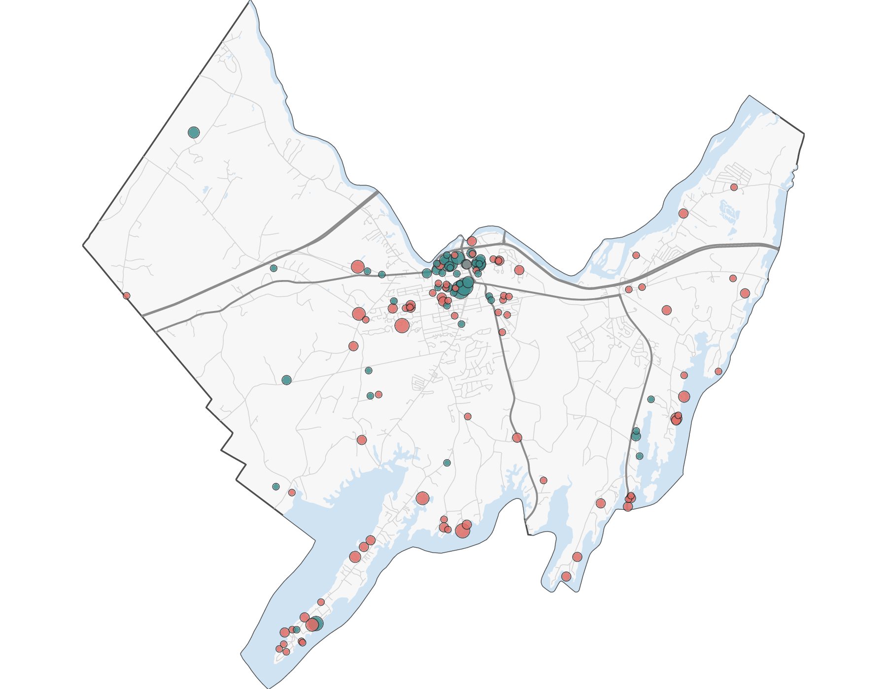{.title-map fig-alt="Map of Brunswick, Maine, with a dot for each short-term rental listing"}

[Jack O'Brien &middot; October 2026 &middot; Version 2]{.deck-date}

## Main arguments

1. **(Primarily) Renters in Brunswick are struggling.**\
   More than half of renters spend too much of their income on housing, and it is getting worse.
   Rents for apartments on the market are far above what a typical renter can pay.

2. **Rents are rising because there are almost no empty rentals.**\
   When few apartments are empty, renters compete for them and rents go up.
   A town needs some empty rentals, roughly 6–7% of them, for rents to hold steady.
   Brunswick has close to none.

3. **Short-term rentals take up a large share of the room the town needs.**\
   Homes rented to visitors (on sites like Airbnb) are not available to people who live here.
   The ones we can locate alone equal more than half (about 55%) of the empty rentals a healthy market needs.

## Some useful terms

- [Cost burdened]{.term}: a household that spends 30% or more of its income on housing
  (rent and utilities for renters; mortgage, taxes, and insurance for owners).
  This is the federal government's standard.
- [Vacancy rate]{.term}: of all the rental homes in town, the share that are empty and available to rent.
- [Short-term rental (STR)]{.term}: a home rented to visitors for short stays, often through
  Airbnb or Vrbo, instead of to someone who lives here.
- [American Community Survey (ACS)]{.term}: a survey the U.S. Census Bureau runs every year.
  For a town the size of Brunswick, it combines 5 years of answers; "2020–2024" means one
  estimate built from those 5 years.

## Part 1: Renters are struggling {.section-slide}

Who has trouble paying for housing in Brunswick?

## About 1 in 3 Brunswick households spends too much on housing

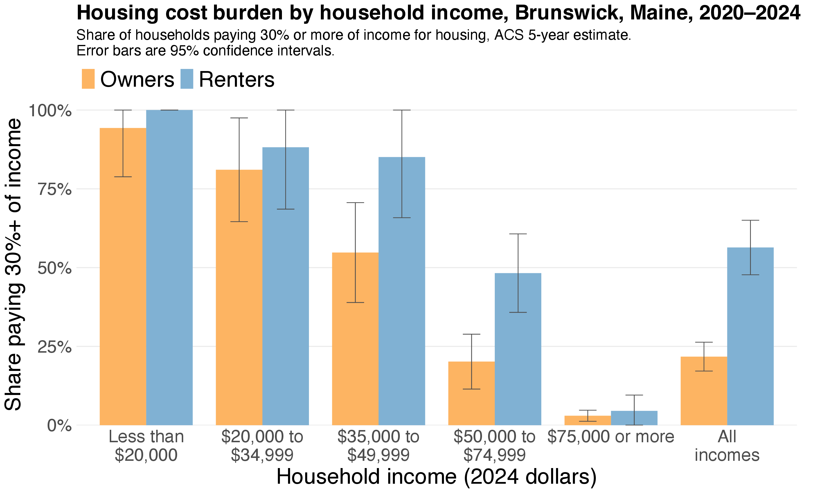{.fig-mid fig-alt="Bar chart: share of Brunswick households paying 30% or more of income for housing, by income, owners and renters"}

- 31% of all Brunswick households are cost burdened.
- Among renters, 56% are cost burdened. Among owners, 22% are.
- At every income level, renters are burdened more often than owners.

## Renters are far more likely to be burdened than owners

Households in Brunswick, ACS 2020–2024

| | Cost burdened | Not cost burdened | Odds |
|:--|--:|--:|--:|
| Renters | 1,374 | 1,063 | 1.29 |
| Owners | 1,367 | 4,917 | 0.28 |

- The [odds]{.term} compare the burdened to the not burdened.
  For renters, 1,374 ÷ 1,063 ≈ 1.3: about 13 burdened renters for every 10 who are not.
- For owners, 1,367 ÷ 4,917 ≈ 0.28: about 3 burdened owners for every 10 who are not.
- 1.29 ÷ 0.28 ≈ 4.6, so **the odds that a renter is cost burdened are more than
  four times the odds for an owner.**

## The housing crisis is largely a rental crisis

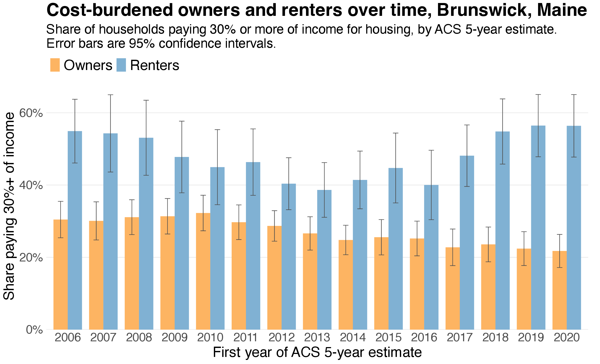{.fig-tall fig-alt="Share of renters and owners who are cost burdened in each ACS 5-year estimate"}

- The difference between rental and owner burdens is getting worse.

## What can a typical renter afford?

:::: {.columns}
::: {.column width="52%"}
- The median renter household in Brunswick earns about **\$49,700 a year**.
- Spending 30% of that on housing comes to **\$1,243 a month**.
  That is the most this household can pay without being cost burdened.
- Half of current renters pay more than **\$1,360** a month.
- Half of the apartments listed for rent on Zillow ask more than **\$2,100** a month.
:::
::: {.column width="46%" .v-center}
| Monthly rent | |
|:--|--:|
| Affordable for the median renter | \$1,243 |
| Median rent, current renters | \$1,360 |
| Median asking rent, new listings | \$2,100 |

[Someone looking for an apartment today faces rents about \$850 a month above what the
typical renter can afford.]{.small}
:::
::::

## Rents for new tenants are far above what renters can afford

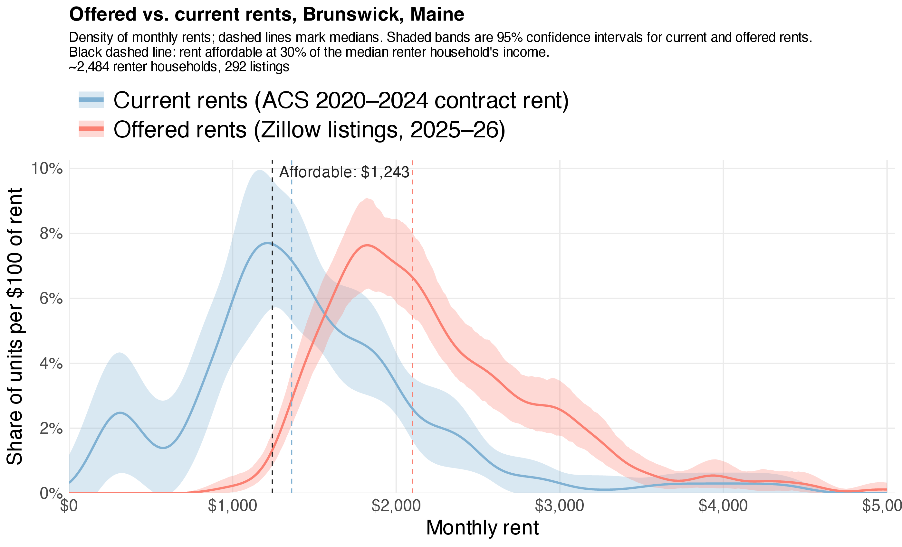{.fig-full fig-alt="Distributions of rents paid by current renters and asking rents on Zillow, with the affordable rent for the median renter marked"}

## Asking rents exceed what renters can afford in every neighborhood

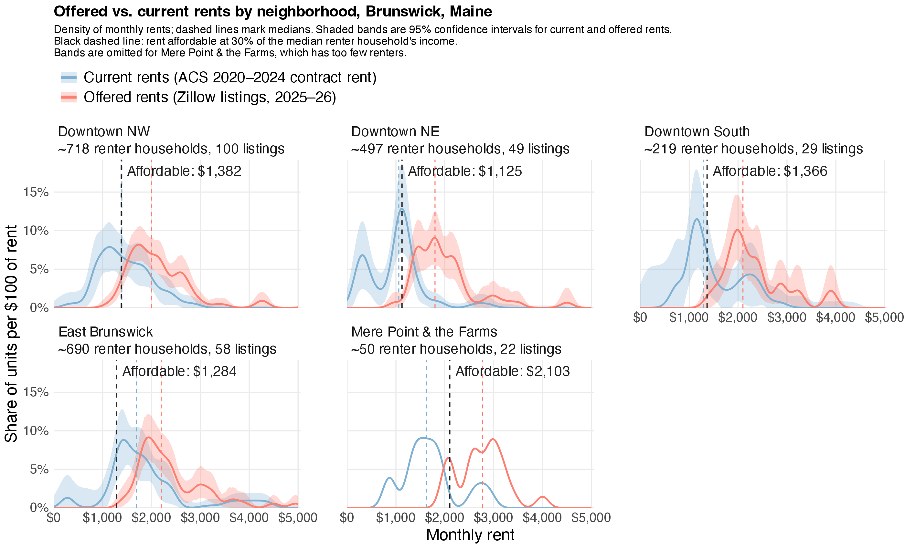{.fig-full fig-alt="Rent distributions by Brunswick neighborhood, current rents and Zillow asking rents"}

## The neighborhoods used in these charts

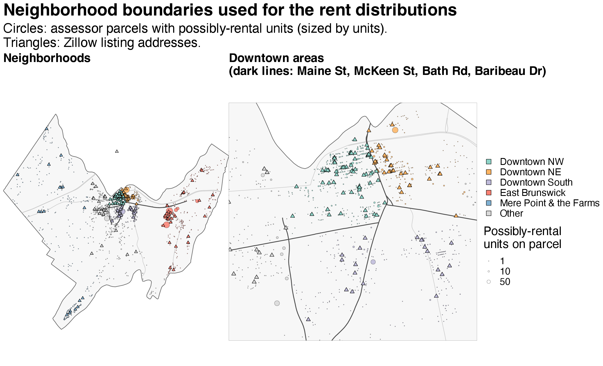{.fig-tall fig-alt="Map of Brunswick colored by neighborhood, with a close-up of downtown"}

[Left: the whole town, colored by neighborhood. Right: a close-up of downtown, split into
quarters by Maine St, McKeen St, and Bath Rd. Circles are homes that may be rented; triangles are
Zillow listings.]{.small}

## Part 2: Why are rents rising? {.section-slide}

How rents depend on the number of empty rentals

## When and how did rents change?

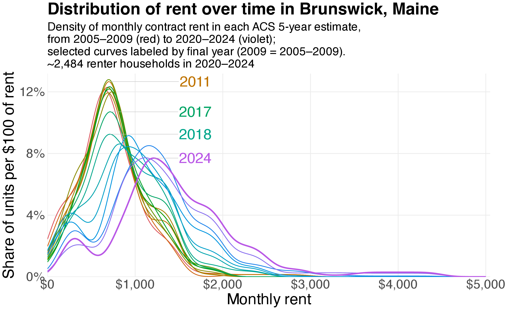{.fig-mid fig-alt="Distribution of Brunswick rents in each ACS 5-year estimate"}

- The whole curve moved to the right after 2016/2017: rents went up for everyone, not just at
  the top. The median rent rose from \$735 (2011–2015) to \$1,360 (2020–2024).
- Covid exacerbated but did not start the crisis.

## Brunswick has run out of vacant rentals

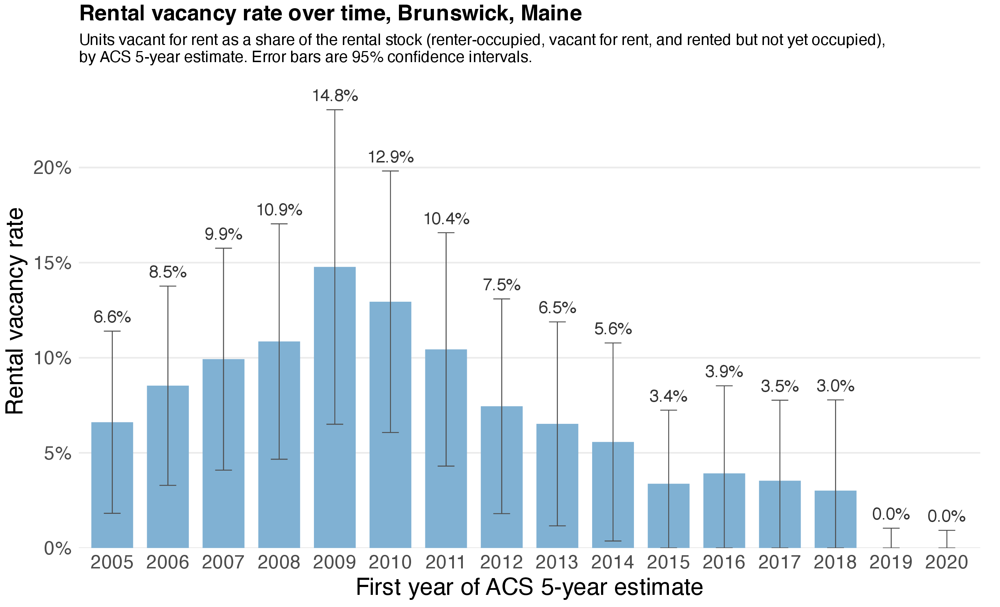{.fig-tall fig-alt="Brunswick rental vacancy rate in each ACS 5-year estimate"}

- About 15% of rentals were empty in the 2009–2013 estimate. In the two most recent estimates,
  the survey found almost none.
- These data include the period after the conclusion of Covid emergency measures.

## Rents and the vacancy rate in Brunswick, 2012–2021

:::: {.columns}
::: {.column width="49%"}
[Distribution of rent]{.small}

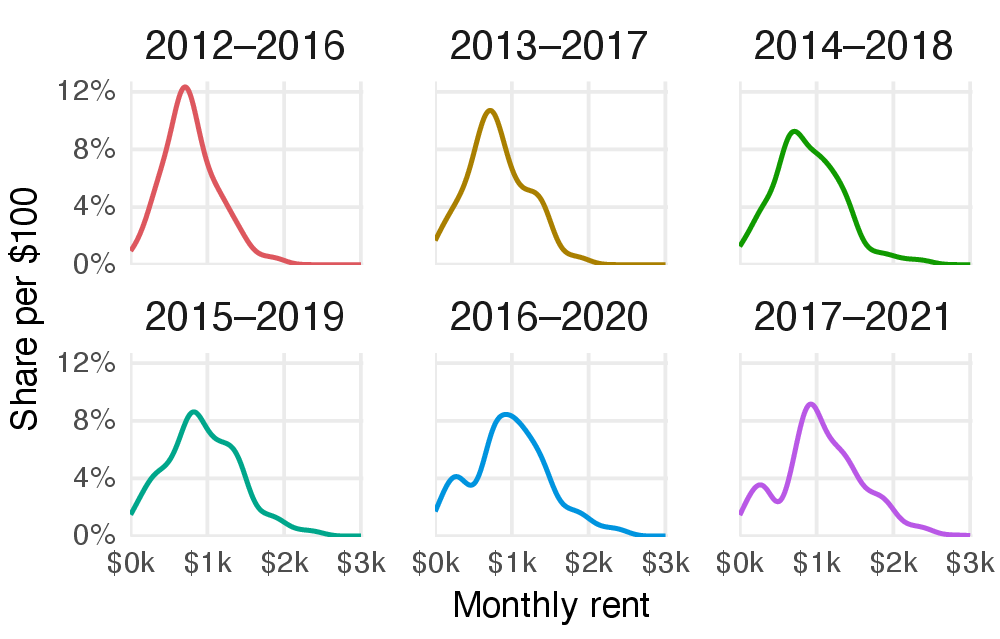{fig-alt="Rent distributions in Brunswick, ACS estimates 2012 to 2021"}
:::
::: {.column width="49%"}
[Rental vacancy rate]{.small}

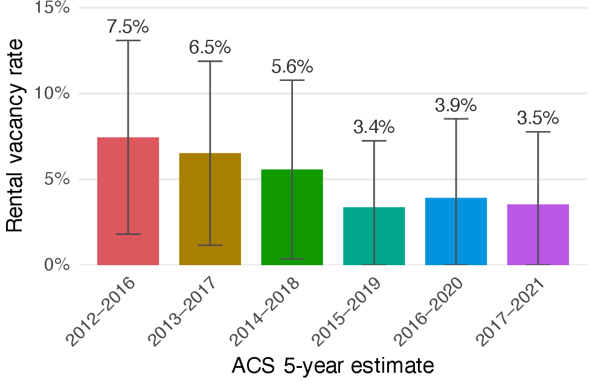{fig-alt="Brunswick rental vacancy rate, ACS estimates 2012 to 2021"}
:::
::::

[While about 6.5–7.5% of rentals were empty (the first two estimates), rents held steady.
As the vacancy rate fell below 6%, the rent curves began to move to the right.]{.small}

## Rents follow the vacancy rate

Rents change according to the availability of rentals, the vacancy rate.

:::: {.columns}
::: {.column width="48%"}
**Few empty rentals**

- Many people compete for each apartment.
- Landlords can raise the rent and still fill it.
- **Rents rise.**
:::
::: {.column width="48%"}
**Many empty rentals**

- Landlords compete for each tenant.
- They must lower rents or offer deals to fill units.
- **Rents fall.**
:::
::::

A healthy market always has *some* empty rentals: people move, families grow,
students arrive, and units sit empty between tenants or for repairs.
The [natural vacancy rate]{.term} of a community is the vacancy rate that causes no pressure on rental
prices. At that rate, rents hold steady.

## A simple model of rents and vacancy

Let $R_t$ be the rent in year $t$, $v$ the current vacancy rate, and $v_n$ the natural vacancy rate.
A simplistic model says:

$$
\underbrace{\frac{R_t - R_{t-1}}{R_{t-1}}}_{\text{percent change in rent}}
= \lambda \times \underbrace{(v_n - v)}_{\text{shortage of empty rentals}}, \qquad \lambda > 0
$$

where $\lambda$ is how quickly rents respond.

- $v < v_n$: too few vacant units, so rents rise
- $v > v_n$: too many vacant units, so rents fall
- $v = v_n$: rents hold steady

[What is the natural vacancy rate of Brunswick?]{.callout-red .big}

## What is a reasonable natural vacancy rate for Brunswick?

[Natural vacancy rate of 6–7%?]{.big .centered}

**Brunswick's own history:** rents held steady when the vacancy rate was about 6.5–7.5%,
and started rising when it fell lower.

**Other benchmarks:**

- 5% is a common threshold for rent protections.
- Maine currently has a vacancy rate of 4.2%.
- The suburban vacancy rate across the US is 7%.

Economists have studied the natural vacancy rate since the 1980s; estimates for U.S. cities vary
widely, and many are higher than 6%. (See the sources at the end.)

## Part 3: Short-term rentals {.section-slide}

How much of the room the town needs do short-term rentals use?

## Short-term rentals take homes off the long-term market

- A home rented to visitors is not available to someone who wants to live in Brunswick.
- In April 2025, the town's report listed **418 short-term rental listings** that meet the
  town's definition of an STR.
- The same home can be listed on more than one website, so 418 listings is not the same as
  418 homes.
- We could place **228** listings on a map, using their address or parcel number.
  The other **190 (45%)** had no address or parcel number in the report.
- Everything that follows counts only the mapped STRs, so it *understates* their effect.

## Where Brunswick's short-term rentals are

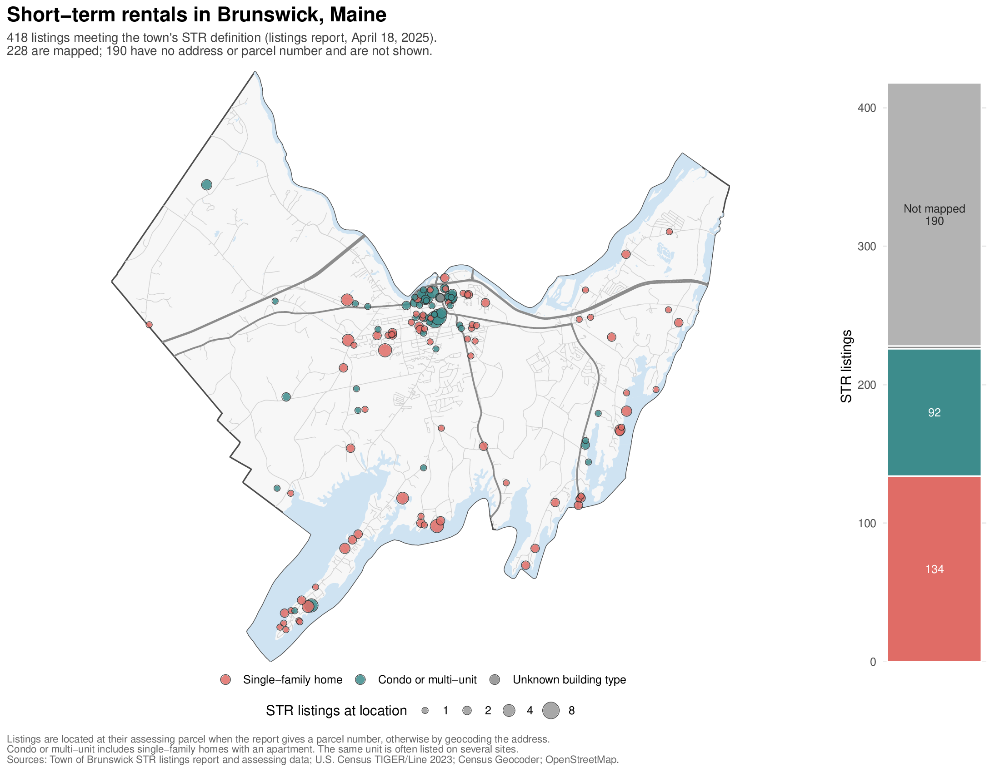{.fig-full fig-alt="Map of Brunswick's short-term rental listings by building type, with a bar of mapped and unmapped listings"}

## Downtown, most STRs are in condos and multi-unit buildings

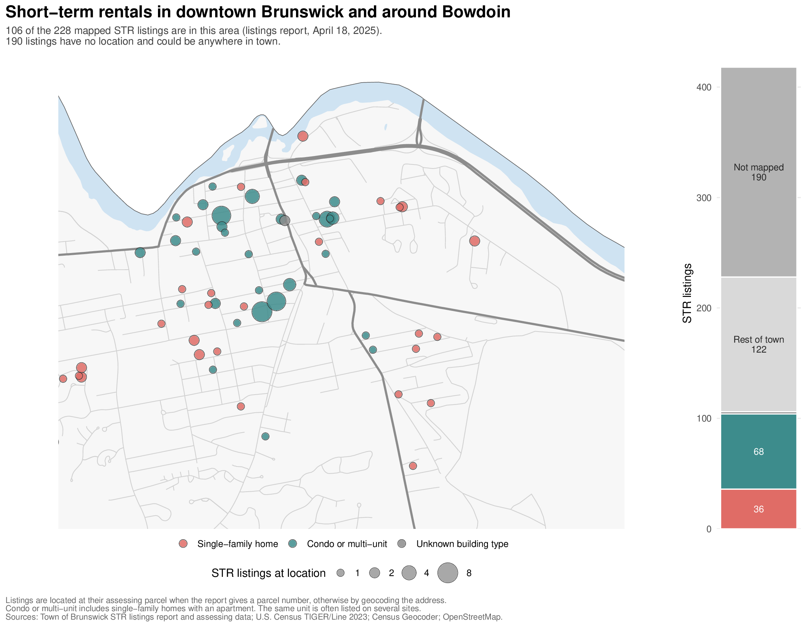{.fig-full fig-alt="Close-up map of downtown Brunswick's short-term rental listings by building type"}

## Mapped STRs take up 55% of natural vacancy rate

::: {.str-table}
| | Downtown | East Bruns. | Elsewhere | Not mapped | Total STR listings | Town rental units |
|:--|--:|--:|--:|--:|--:|--:|
| Single-family home | 36 | 30 | 68 | – | 134 | 724 |
| Condo, multi-unit, SFH w/ apt. | 68 | 5 | 19 | – | 92 | 2,186 |
| Building type unknown | 2 | – | – | 190 | 192 | – |
| **Total** | **106** | **35** | **87** | **190** | **418** | **3,738** |
:::

[Listings meeting the town's STR definition, April 18, 2025; a unit may be listed on several sites.
Not mapped: no address or parcel number in the town's report.
Rental units: assessing-data units that are rented or have no owner-occupant, excluding STRs;
the total includes 828 mobile homes, senior living, and other units.
The 228 mapped listings are 151 distinct units (77 downtown); shares are units out of rental units plus STR units.]{.tiny}

- STRs take up 3.9% of the rental units in the town.
- STRs take up 3.5% of the rental units downtown.
- This only counts the mapped STRs. 45% are not mapped.

[If we assume a natural vacancy rate of 7%, then just the mapped STRs occupy 55% of them.]{.callout-red}

## Why 55%?

- For rents to hold steady, about **7 out of every 100** rental homes should be empty and
  available.
- The 228 listings we can map are 151 distinct homes. That is about **3.9 of every 100**
  rental homes in town (151 out of 3,889).
- 3.88 ÷ 7 ≈ 0.55. So the mapped STRs equal about **55%** of the empty rentals that
  a healthy market needs.
- Brunswick's vacancy rate is near zero. If those homes were rented to residents instead,
  they would fill more than half of the gap between that and a 7% natural rate.
- The 190 STR listings we could not map would add to this.

## Summary

1. **Renters are struggling.** 56% of Brunswick renters are cost burdened, up from 40% in the
   2016–2020 estimate. New listings ask about \$2,100 a month; the typical renter can afford about \$1,243.
2. **Rents are rising because empty rentals have disappeared.** Rents held steady when about
   6–7% of rentals were empty. Today the survey finds almost none.
3. **Short-term rentals use a large share of the room the town needs.**
   The STRs we can map equal about 55% of a 7% natural vacancy rate, and 45% of listings
   could not be mapped at all.

## Data, code, and sources {.sources}

:::: {.columns}
::: {.column width="42%"}
**Data used in this analysis**

- U.S. Census Bureau, American Community Survey 5-year estimates, 2005–09 to 2020–24, Brunswick
  town and block groups: B25003, B25004 (vacancy), B25056 (rent), B25074 (renter income),
  B25106 (cost burden).
- Town of Brunswick, short-term rental listings report, April 18, 2025.
- Town of Brunswick assessing data (parcels, property cards), Sept. 2026.
- Zillow rental listings for Brunswick, collected daily, June 2025–April 2026.
- Census TIGER/Line 2023; Census Geocoder; OpenStreetMap.

**Code**

One commented [R script](../files/brunswick-housing/brunswick_housing_analysis.R) makes every figure and table.
The [original slides](../files/brunswick-housing/brunswick_housing_slides_v2.pdf) are also available as a PDF.
:::
::: {.column width="57%"}
**Sources for other claims**

- Cost burden (30%+ of income): HUD, "Rental Burdens: Rethinking Affordability Measures,"
  *PD&R Edge*, 2014.
- 5% threshold: N.Y. Emergency Tenant Protection Act of 1974, Unconsol. Laws § 8623(a).
- U.S. suburban rental vacancy, 6.9%: Census Bureau, Housing Vacancies and Homeownership
  (CPS/HVS), Q4 2025.
- Maine rental vacancy rate: Census Bureau, ACS 2020–24 5-year estimates, table DP04.

**The natural vacancy rate**

- Rosen & Smith (1983). The price-adjustment process for rental housing and the natural vacancy
  rate. *American Economic Review* 73(4): 779–786.
- Gabriel & Nothaft (1988). Rental housing markets and the natural vacancy rate.
  *AREUEA Journal* 16(4): 419–429.
- Gabriel & Nothaft (2001). Rental housing markets, the incidence and duration of vacancy,
  and the natural vacancy rate. *Journal of Urban Economics* 49(1): 121–149.
:::
::::
