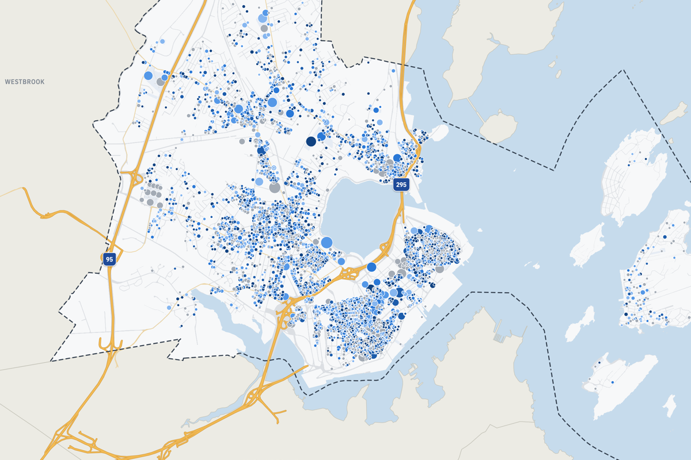

Every year, Portland's landlords report each unit's rent to the city. I collected five years of those filings (2021–2025): 5,353 rental buildings and about 95,000 unit-year records, each placed on its tax parcel. There are two ways to look at them.

## Check your rent

Type in your address and pick your unit. The check reads the unit's registrations and tells you whether the registered rent increases stay within the city's limits, or whether something deserves a closer look.

```{=html}
<p><a class="btn btn-primary" href="../files/portland-rent-map/check.html" target="_blank" rel="noopener">Open the Portland rent check &rarr;</a></p>
```

A flag is a lead worth checking, not a legal finding.

## Explore the registry map

The full map has a dot for every registered rental building. Click a building to see every rent reported for it, along with the owner, the allowable rent and how the building scores on compliance.

```{=html}
<a class="map-link" href="../files/portland-rent-map/index.html" target="_blank" rel="noopener">
  
  <span class="map-link-label">Open the Portland rent registry map &rarr;</span>
</a>
```

[&larr; Back to Outreach](../outreach.qmd)
