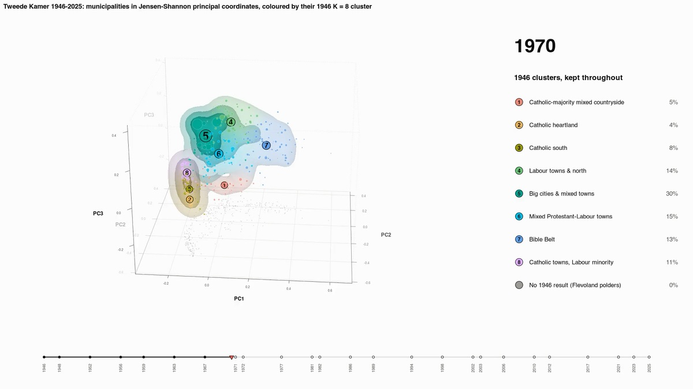
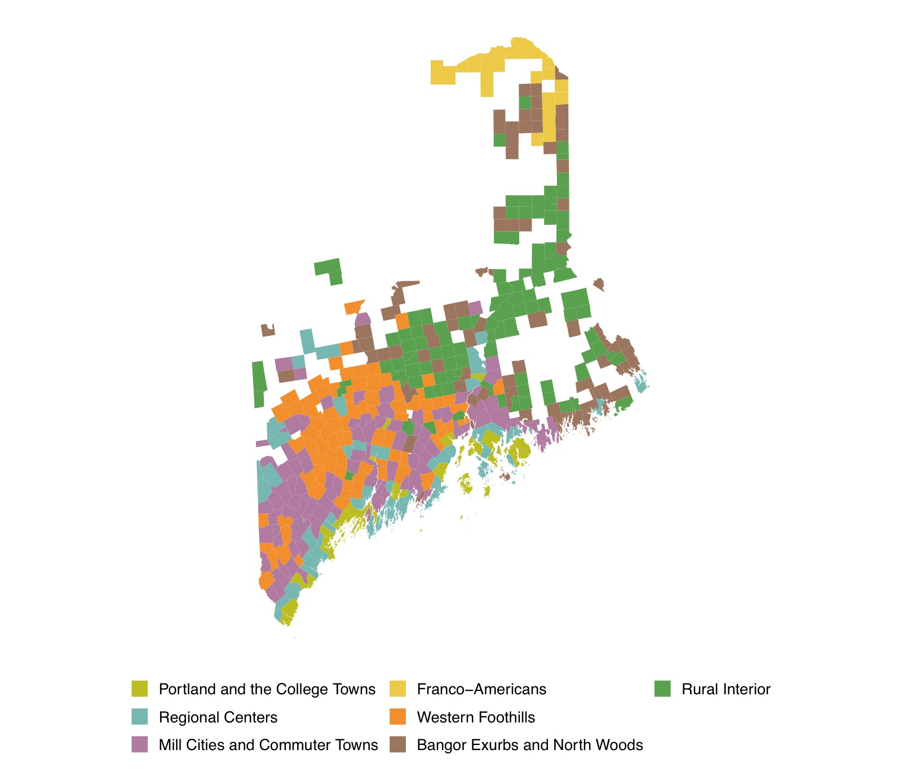

My research develops Bayesian models, mostly mixture models, to find interpretable structure in complex data. I started in statistical phylogenetics and genetics (viral evolution, malaria genomics, microbial metagenomics). These days I work mainly on social science: political structure in election data, cultural patterns in the archaeological record, and the rhythms of social life online.

::: {.card-grid}

::: {.pcard}
::: {.pcard-img}
{fig-alt=""}
:::
::: {.pcard-body}
### [Mapping voting blocs](research/voting-blocs.qmd)

A model from population genetics, applied to election returns. The blocs it finds are neither left nor right, strikingly spatial, and stable across elections.
:::
:::

::: {.pcard}
::: {.pcard-img}
{fig-alt=""}
:::
::: {.pcard-body}
### [Local politics](research/local-politics.qmd)

What divides voters when the parties aren't on the ballot: Maine, California and places across the country.
:::
:::

::: {.pcard}
::: {.pcard-img}
{fig-alt=""}
:::
::: {.pcard-body}
### [Politics worldwide](research/worldwide.qmd)

The same model on referendum returns from the Netherlands and Switzerland.
:::
:::

::: {.pcard}
::: {.pcard-img}
{fig-alt=""}
:::
::: {.pcard-body}
### [Maine's history](research/maine-history.qmd)

A long view of Maine's political geography.
:::
:::

::: {.pcard}
::: {.pcard-img}
{fig-alt=""}
:::
::: {.pcard-body}
### [Statistical innovations](research/methods.qmd)

The beta-binomial mixture model, how to fit it, and how to pin down the number of blocs. Plus pottery and propaganda.
:::
:::

::: {.pcard}
::: {.pcard-body}
### [Publications](research/publications.qmd) and [talks](research/talks.qmd)

Twenty-one peer-reviewed papers, from viral evolution to voting blocs.
:::
:::

:::

## Recent research news

::: {#research-news}
:::
