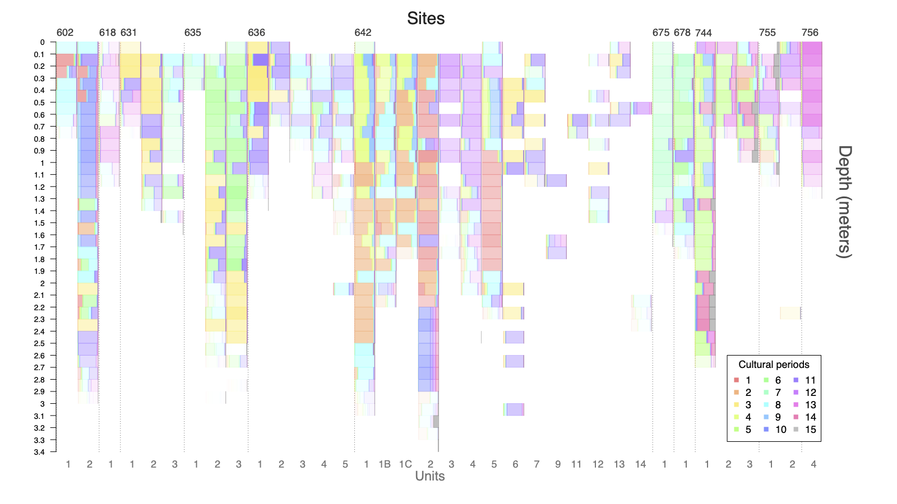
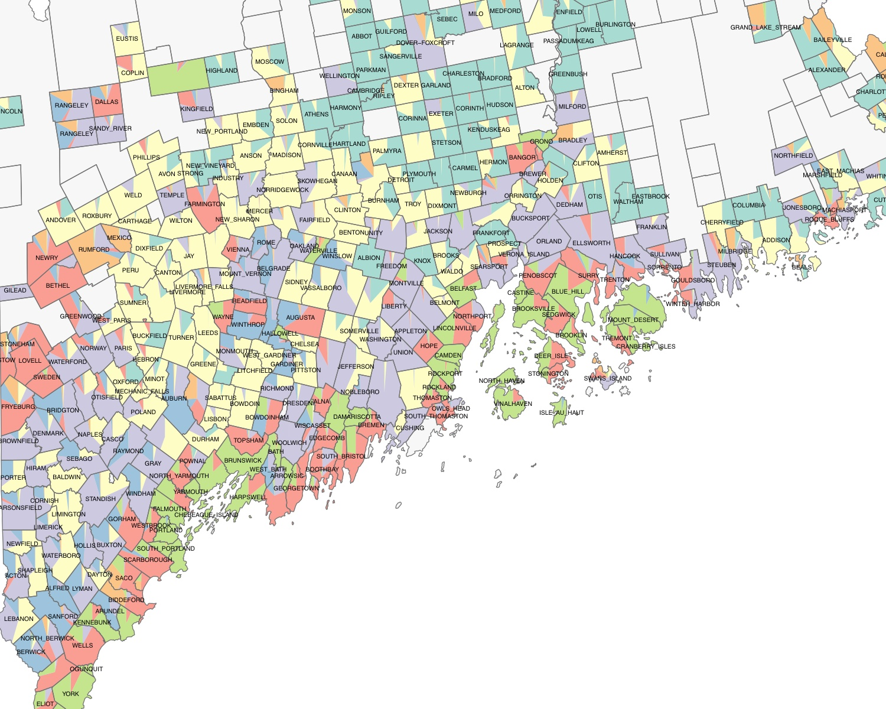
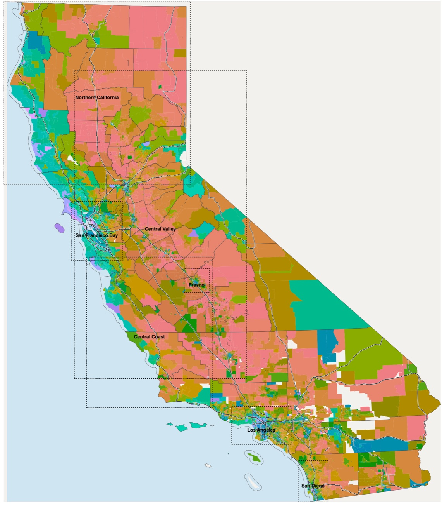
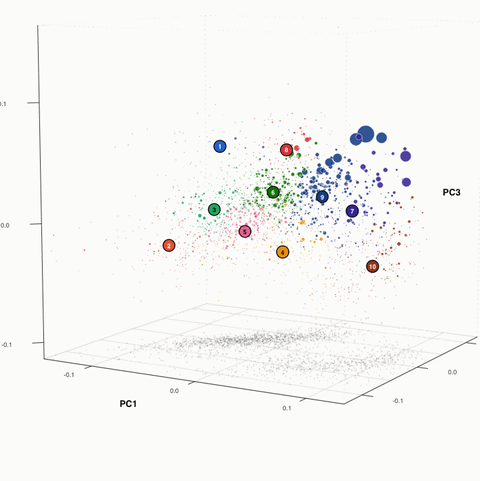

My research develops Bayesian mixture models to find interpretable structures in complex data. While I started in statistical phylogenetics and genetics (viral evolution, malaria genomics, microbial metagenomics), these days I work mainly on social science: political structure in election data, cultural patterns in the archaeological record, and the rhythms of social life online.

::: {.card-grid .two-up}

::: {.pcard}
::: {.pcard-img}
[{fig-alt="Inferred cultural periods by depth at Lake Chad Basin excavation sites"}](research/methods.qmd)
:::
::: {.pcard-body}
### [Statistical innovations](research/methods.qmd)

The Beta-binomial mixture model. How to fit it. How to nail down the number of blocs. Some pieces of pottery. Extensions.
:::
:::

::: {.pcard}
::: {.pcard-img}
[{fig-alt="Map of Maine towns coloured by voting bloc"}](research/voting_bloc_slides.html)
:::
::: {.pcard-body}
### [Mapping voting blocs](research/voting_bloc_slides.html) <!-- link: research/voting-blocs.qmd (page being written); for now opens the Maine slides -->

How to map voting blocs? Blocs are neither left nor right but highly spatial and stable across elections. Maine politics redux.
:::
:::

::: {.pcard}
::: {.pcard-img}
[{fig-alt="Map of California precincts coloured by voting bloc" .contain}](research/local-politics.qmd)
:::
::: {.pcard-body}
### [Local politics](research/local-politics.qmd)

How local is politics? Mapping the demographic structure of voting blocs across the US, including California, Miami, and NYC.
:::
:::

::: {.pcard}
::: {.pcard-img}
[{fig-alt="Rotating 3-D plot of Swiss communes on the first three principal coordinates of their referendum votes, 1995–2005, coloured by voting bloc" .contain}](research/worldwide.qmd)
:::
::: {.pcard-body}
### [Politics worldwide](research/worldwide.qmd)

What structures voting blocs within and across countries? Case studies of eighty years of Dutch elections and four decades of Swiss referendums, with more countries to come.
:::
:::

:::

## Publications and talks

See the full list of [publications](research/publications.qmd) and [talks](research/talks.qmd). I publish as John D. O'Brien.
