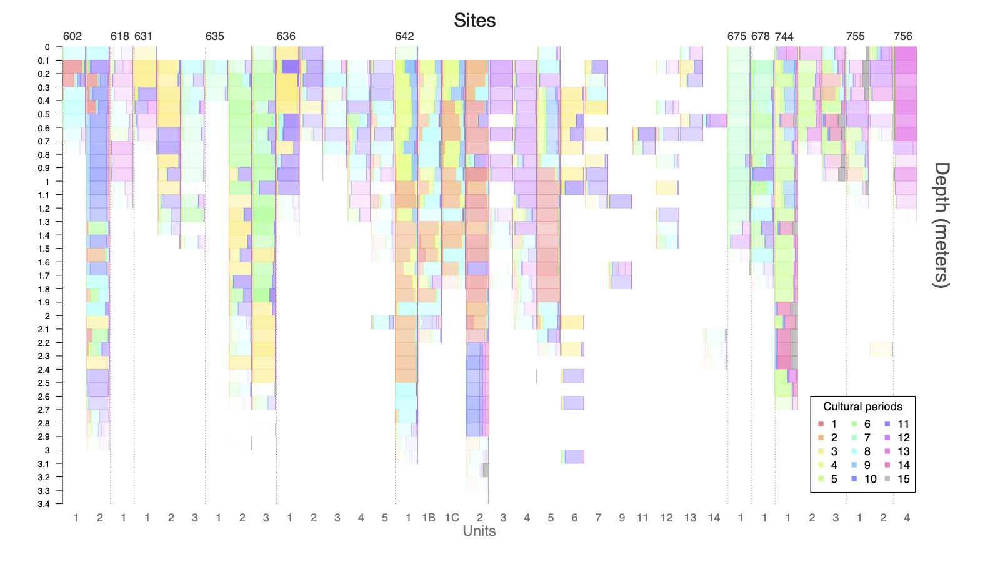
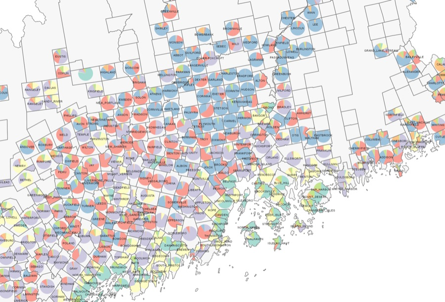
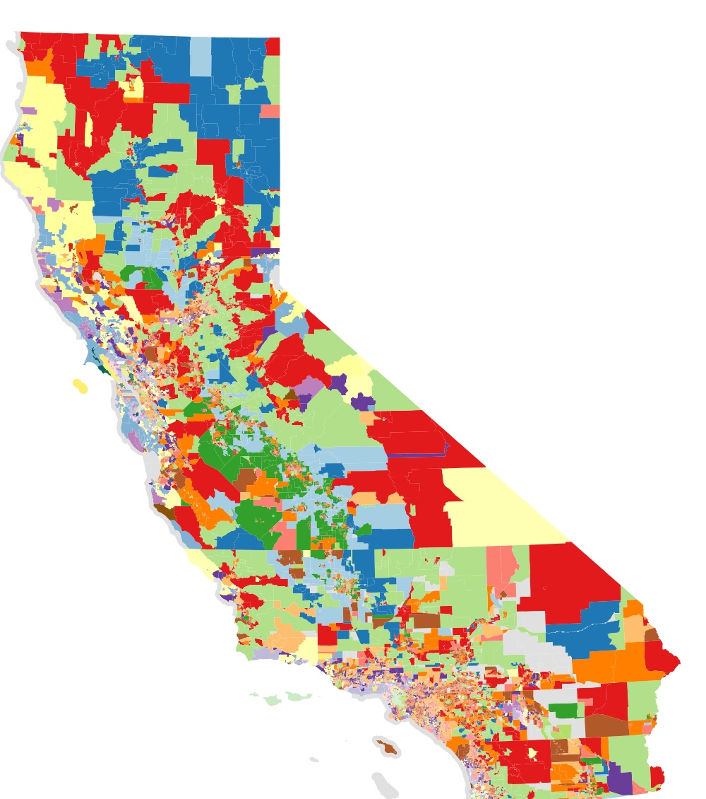
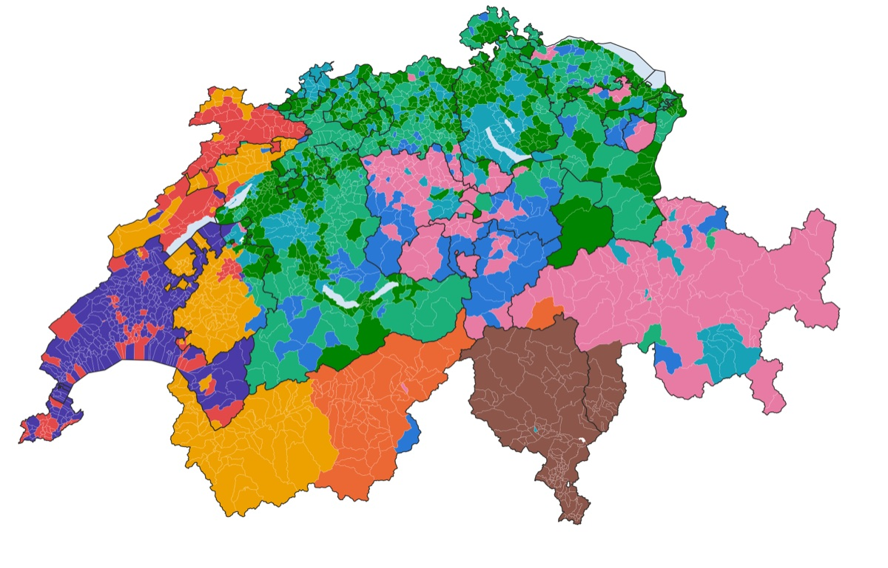

My research develops Bayesian mixture models to find interpretable structures in complex data. While I started in statistical phylogenetics and genetics (viral evolution, malaria genomics, microbial metagenomics), these days I work mainly on social science: political structure in election data, cultural patterns in the archaeological record, and the rhythms of social life online.

::: {.card-grid}

::: {.pcard}
::: {.pcard-img}
{fig-alt=""}
:::
::: {.pcard-body}
### [Statistical innovations](research/methods.qmd)

The Beta-Binomial Mixture Model. How to Fit It. How to Pin Down the Number of Blocs. Extensions. Some Pieces of Pottery.
:::
:::

::: {.pcard}
::: {.pcard-img}
{fig-alt=""}
:::
::: {.pcard-body}
### [Mapping voting blocs](research/voting-blocs.qmd)

A model from population genetics, applied to election returns. The blocs it finds are neither left nor right, strikingly spatial, and stable across elections.
:::
:::

::: {.pcard}
::: {.pcard-img}
{fig-alt=""}
:::
::: {.pcard-body}
### [Local politics](research/local-politics.qmd)

What divides voters when the parties aren't on the ballot: Maine, California and places across the country.
:::
:::

::: {.pcard}
::: {.pcard-img}
{fig-alt=""}
:::
::: {.pcard-body}
### [Politics worldwide](research/worldwide.qmd)

Mapping local politics in a variety of electoral structures. The Netherlands, Switzerland, Croatia, Botswana, and Korea (to start).
:::
:::

::: {.pcard}
::: {.pcard-body}
### [Publications](research/publications.qmd) and [talks](research/talks.qmd)

Twenty-one peer-reviewed papers, from viral evolution to voting blocs.
:::
:::

:::

## Recent research news

::: {#research-news}
:::
