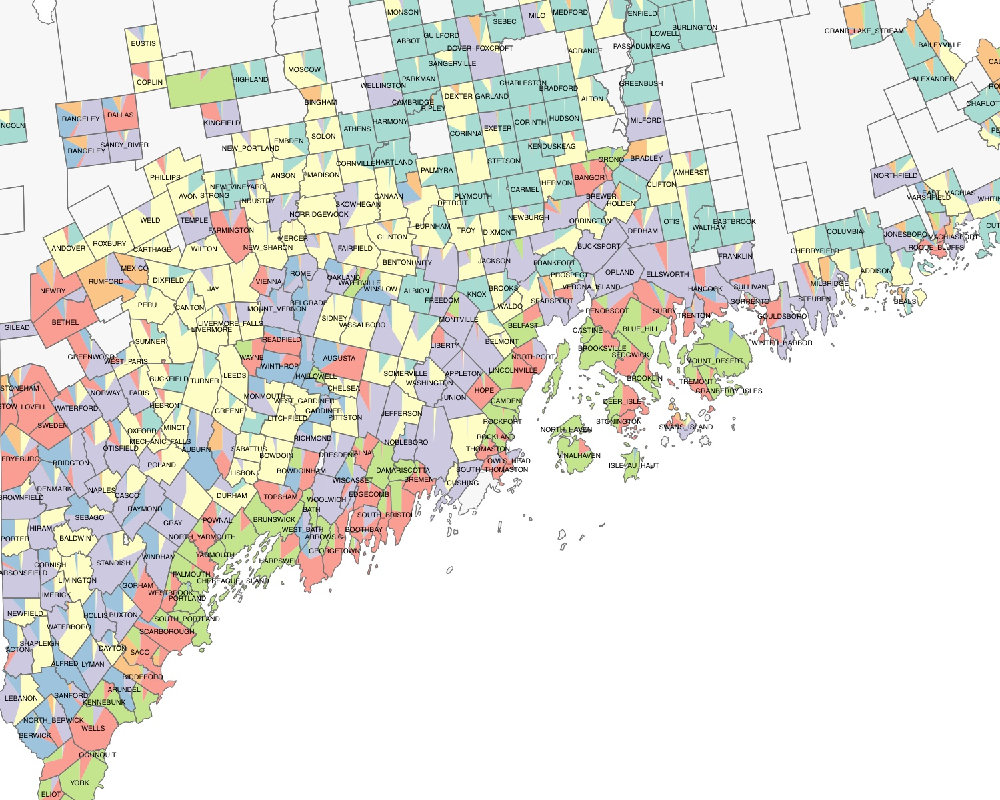
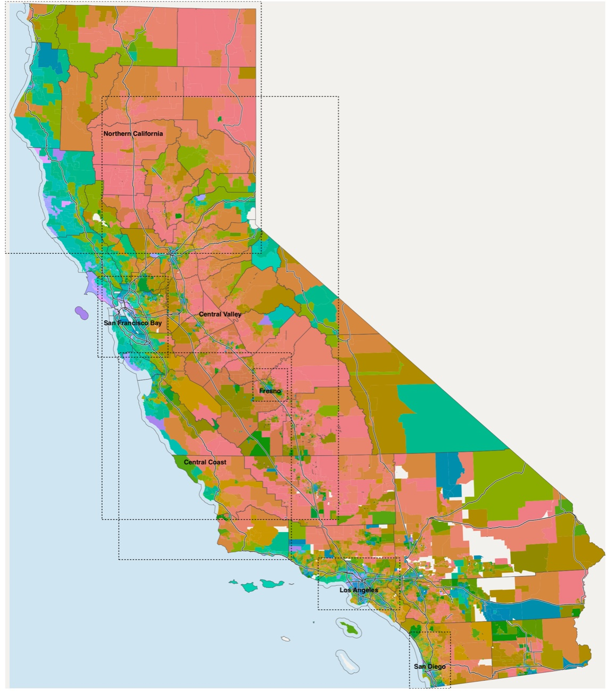
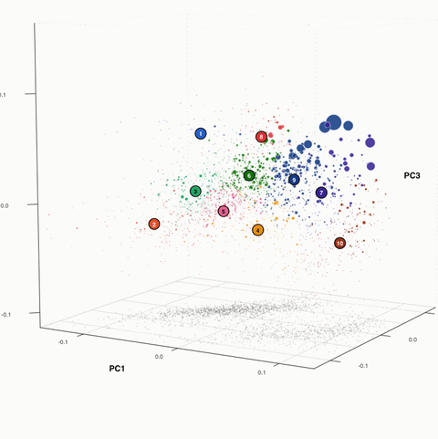

My research develops Bayesian mixture models to find interpretable structures in complex data. While I started in statistical phylogenetics and genetics (viral evolution, malaria genomics, microbial metagenomics), these days I work mainly on social science: political structure in election data, cultural patterns in the archaeological record, and the rhythms of social life online.

::: {.card-grid .two-up}

::: {.pcard}
::: {.pcard-img}
{fig-alt=""}
:::
::: {.pcard-body}
### Statistical innovations <!-- link: research/methods.qmd -->

The Beta-binomial mixture model. How to fit it. How to nail down the number of blocs. Some pieces of pottery. Extensions.
:::
:::

::: {.pcard}
::: {.pcard-img}
{fig-alt=""}
:::
::: {.pcard-body}
### Mapping voting blocs <!-- link: research/voting-blocs.qmd -->

How to map voting blocs? Blocs are neither left nor right but highly spatial and stable across elections. Maine politics redux.
:::
:::

::: {.pcard}
::: {.pcard-img}
{fig-alt="" .contain}
:::
::: {.pcard-body}
### Local politics <!-- link: research/local-politics.qmd -->

How local is politics? Mapping the demographic structure of voting blocs across the US, including California, Miami, and NYC.
:::
:::

::: {.pcard}
::: {.pcard-img}
{fig-alt="Rotating 3-D plot of Swiss communes on the first three principal coordinates of their referendum votes, 1995–2005, coloured by voting bloc" .contain}
:::
::: {.pcard-body}
### Politics worldwide <!-- link: research/worldwide.qmd -->

What structures voting blocs within and across countries? Case studies in the Netherlands, Switzerland, Croatia, Botswana and Korea (to start).
:::
:::

:::
