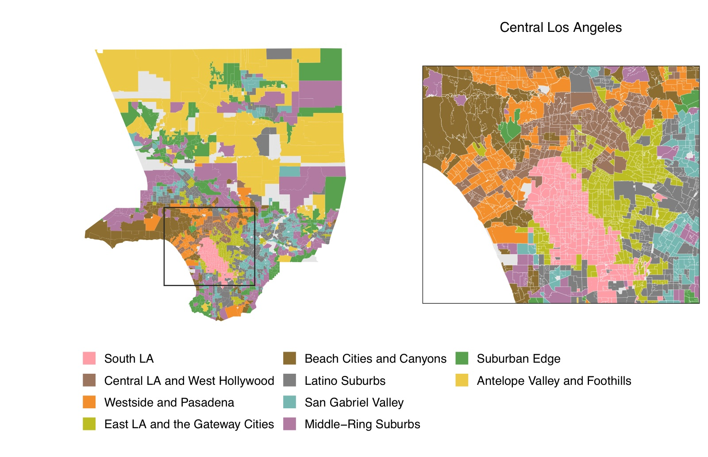

National politics in the United States has collapsed onto a single axis: if you know how a place voted for president, you can predict most of how it votes on everything else. But local ballots are full of questions the parties never take a side on, such as daylight saving time, a casino in Oxford County or a new state flag. On those questions, what divides voters?

With Aaron Kaufman, I've been applying the [voting-bloc model](voting-blocs.qmd) to precinct- and town-level referendum returns from places across the country. The answer is the same everywhere we've looked so far. Every place has local structure that national partisanship can't reproduce, that structure is strongly spatial, and it comes in a small number of recognizable types.

::: {.callout-note appearance="simple"}
**Status:** paper in draft, "The Structure of Conflict in Local Politics" (Kaufman & O'Brien).
:::

## Maine

Maine votes on a lot of ballot questions: 72 statewide questions from 2008 to 2025 across about 460 towns. It is also one of the most nationalized places we study, since presidential vote alone explains most of the variation on a typical question. Even so, the model finds seven blocs, and they explain more than presidential vote on all 72 questions.

{fig-alt="Map of Maine towns colored by voting bloc: Franco-Americans along the northern border, Rural Interior and Bangor Exurbs through the middle, Western Foothills and Mill Cities in the southwest, and Portland and the College Towns along the coast." width="85%" fig-align="center"}

The most distinctive bloc is the smallest. **Franco-Americans** is northern Aroostook County and the upper St. John Valley: Presque Isle, Caribou, Fort Kent and Madawaska. One resident in five there speaks French at home, against 1 to 2 percent everywhere else. It sits close to the coastal **Regional Centers** on partisanship but splits from them sharply on social questions, including both same-sex marriage referendums and the 2024 flag.

Some of Maine's most characteristic ballots are almost invisible to partisanship. On the two Oxford County casino referendums, presidential vote explains 2 to 3 percent of the variation and the blocs explain 30 to 35 percent.

## California

California's propositions cover the whole state: more than 22,000 precincts voting on the same statewide questions.

{fig-alt="Map of California precincts in many colors, showing large rural blocs in the north and east and a dense patchwork in the Bay Area and Southern California." width="70%" fig-align="center"}

Zooming in, Los Angeles County alone has nearly 3,000 precincts voting on 74 propositions from 2012 to 2024, and the model finds ten blocs there.

{fig-alt="Map of Los Angeles County precincts colored by ten voting blocs, with an enlarged inset of central Los Angeles showing South LA, East LA and the Gateway Cities, and the Westside." width="100%"}

The pattern that repeats across the county is a pair of blocs with the same partisanship but different preferences: a mostly white, college-educated bloc next to a mostly Latino or Black bloc that votes for Democrats at the same rate. Daylight saving time is the clearest example. Partisanship says almost nothing about how a precinct voted on it, while the blocs explain most of the variation.

We are also fitting Los Angeles and San Francisco jointly, to ask whether California's two big metros share blocs. So far, they mostly don't.

## Across the country

The project now covers statewide panels for Colorado, Maine and Massachusetts, metropolitan panels for Los Angeles, San Francisco, South Florida, Chicago, Washington, DC, Salt Lake County and Portland, Oregon, and New York City. New builds are under way for about twenty more states and cities. A map of the full coverage will go here when the paper is public.

<!-- TODO: Jack: add a public version of figures/us_coverage_map.pdf once the place list is settled. -->

## Recent updates

::: {#local-news}
:::
