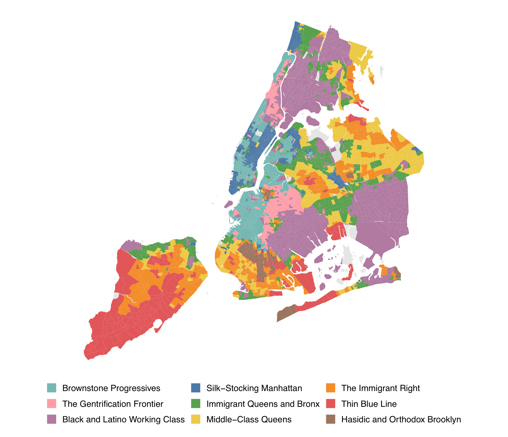

If you listen to the news you might think that all American politics are just about who voted for which president. But thousands of local ballot measures are packed with questions parties never take a side on: daylight saving time, a casino, a new state flag. On those questions, how do voters vote? How do these connect with national identification? And what can this tell us about the structure of urban politics?

With [Aaron Kaufman](https://aaronrkaufman.com/), I've been applying the [voting-bloc model](voting-blocs.qmd) to precinct- and town-level referendum returns from states and cities across the US. What we've learned is remarkable: while there are similarities across cities, the structure of electoral politics within urban America is structurally diverse, consistent across time, and filled with surprising historical, cultural, and demographic determinants.

[{fig-alt="Map of New York City election districts colored by nine voting blocs, including Brownstone Progressives, Silk-Stocking Manhattan, Black and Latino Working Class, Middle-Class Queens, Thin Blue Line and Hasidic and Orthodox Brooklyn." width="80%" fig-align="center"}](atlas.qmd)

In New York City, the model uncovers nine voting blocs in the 30 city and state ballot proposals decided between 2014 and 2024. Those blocs, all estimated before the 2025 Democratic mayoral primary, explain 58 percent of the variation in Zohran Mamdani's vote share across election districts, where national partisanship only explains 14 percent. The key split ran inside the Democratic party: Brownstone Progressives and Black and Latino Working Class vote alike for president (90 and 91 percent Democratic, respectively), yet Mamdani won 73 percent of the final-round vote in the first group but only 39 percent in the second.

Our manuscript, "The Structure of Local Politics" is currently available for review on request.
