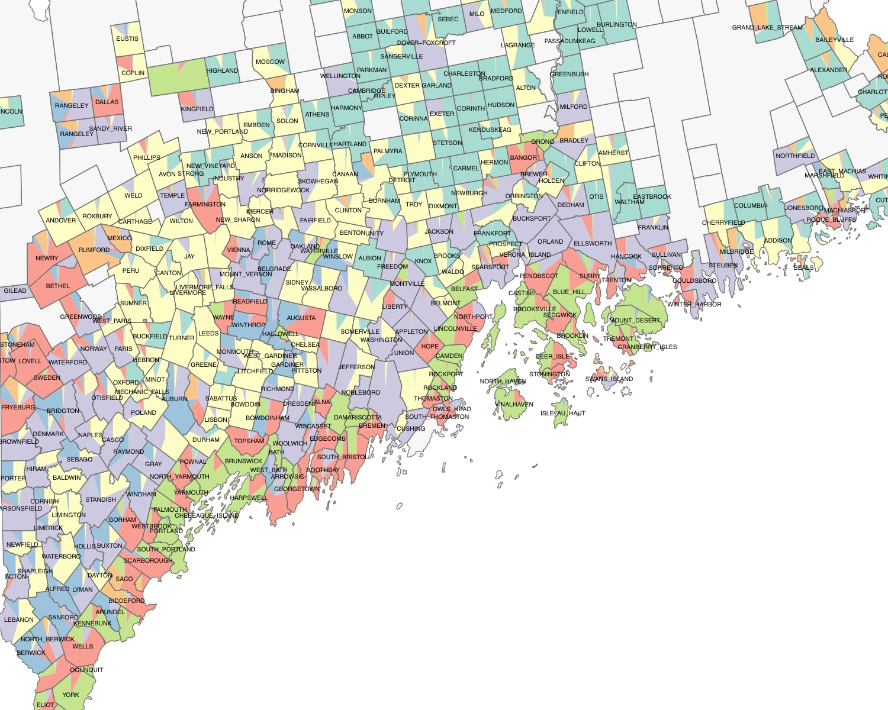
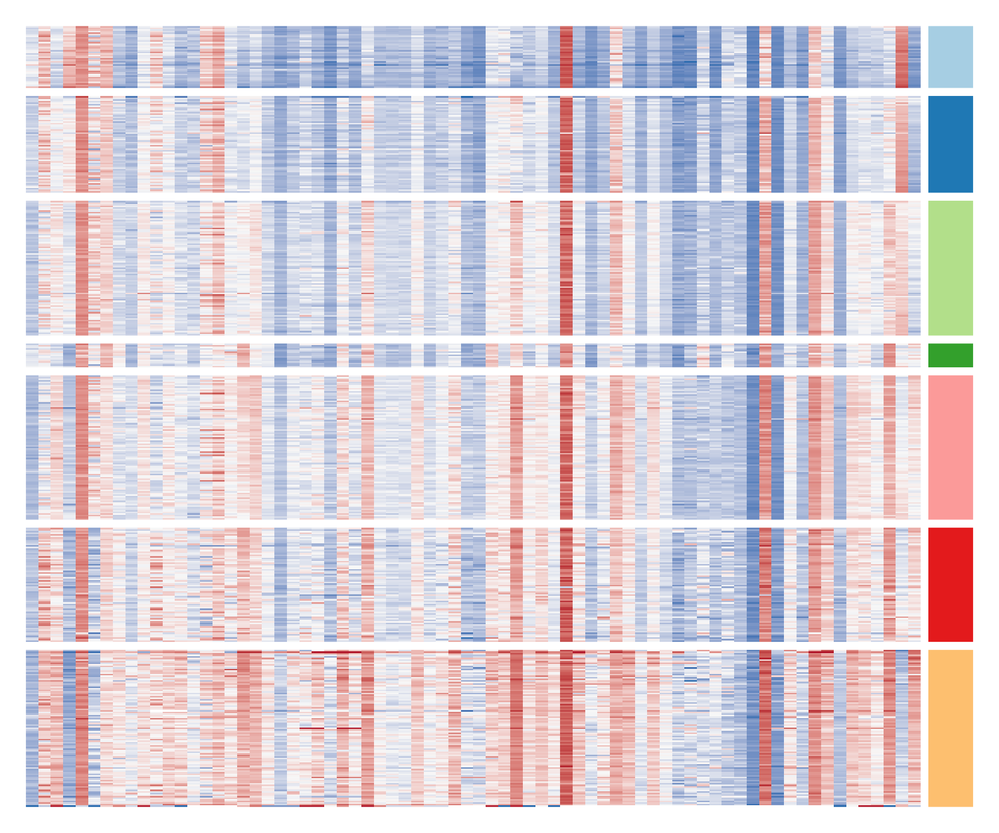

A voting bloc — a group of individuals that vote in a similar fashion — is a foundational concept to electoral, legislative, and judicial analysis. However, these analyses are almost always restricted to data where individual votes are directly observed. An excellent example would be a legislative voting record. The Beta-Binomial Mixture model (and subsequent model developments) provides a way to infer voting blocs from a new type of data: voting precincts, thousands of voters all mixed together. Crucially, this allows us to infer voting blocs from real electoral data, which has not previously been done with standard election data. The model works best with referendum data, though candidate data can be used with some constraints. Applied to locations across the US, we find that voting blocs are highly spatial, strongly connected to demographic changes, and consistent across time.

John D. O'Brien. 2026. "A Bayesian mixture model captures temporal and spatial structure of voting blocs within longitudinal referendum data." *Political Science Research and Methods*, 1–22. [doi](https://doi.org/10.1017/psrm.2025.10050) · [arXiv](https://arxiv.org/abs/2301.01677)

## Slides

::: {.card-grid .two-up}

::: {.pcard}
::: {.pcard-img}
{fig-alt="Map of Maine towns, each filled with its mix of seven voting blocs."}
:::
::: {.pcard-body}
### [Voting blocs in Maine](voting_bloc_slides.html)

A non-mathematical introduction: what a voting bloc is, how we find them from referendum returns, and what Maine's seven blocs look like.
:::
:::

::: {.pcard}
::: {.pcard-img}
{fig-alt="Heatmap of yes shares for Maine towns (rows) on 72 ballot questions (columns), with the towns grouped into seven voting blocs, each marked by a colour bar." .contain}
:::
::: {.pcard-body}
### A more thorough introduction

The mathematical version: the beta-binomial mixture model, how it is fitted and how the number of blocs is chosen. Slides coming soon.
:::
:::

:::
