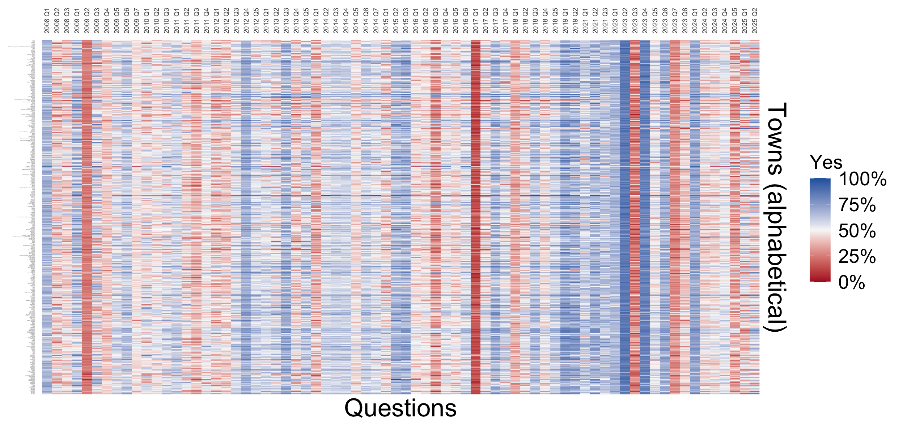

## Abstract

The estimation of voting blocs is an important statistical inquiry in political science. However, the scope of these analyses is usually restricted to roll call data where individual votes are directly observed. Here, we examine a Bayesian mixture model with Dirichlet-multinomial components to infer voting blocs within longitudinal referendum data aggregated at the municipal level. As a case study, we analyze vote totals from 423 municipalities in the US state Maine for 54 referendum questions balloted from 2008-2019. Using this model, we recover the posterior distribution on the number of voting blocs, the support for each question within each bloc, and the blocs' mixture within each municipality. We find that these voting blocs are structured by geography and are largely consistent across the study period. Further analysis of the posterior distribution provides three additional findings: voting blocs exhibit both gradients and discontinuities in their overall structure that are consistent with geography and culture; a small number of questions are inconsistent with the statewide bloc structure and these questions' content relate to specific regions; and that the blocs exhibit evidence of increased polarization across blocs during the study period. We conclude with an outline of statistical extensions of this model, connections to other statistical frameworks in political science (such as polling), and detail candidate locations for subsequent applications of the model.

John D. O'Brien. 2026. "A Bayesian mixture model captures temporal and spatial structure of voting blocs within longitudinal referendum data." *Political Science Research and Methods*, 1–22. [doi](https://doi.org/10.1017/psrm.2025.10050) · [arXiv](https://arxiv.org/abs/2301.01677)

## Slides

::: {.card-grid .two-up}

::: {.pcard}
::: {.pcard-img}
{fig-alt="Map of Maine towns, each filled with its mix of seven voting blocs."}
:::
::: {.pcard-body}
### [Voting blocs in Maine](voting_bloc_slides.html)

A non-mathematical introduction: what a voting bloc is, how we find them from referendum returns, and what Maine's seven blocs look like.
:::
:::

::: {.pcard}
::: {.pcard-img}
{fig-alt="Heatmap of yes shares for Maine towns (rows) on 72 ballot questions (columns), 2008 to 2025, in red and blue." .contain}
:::
::: {.pcard-body}
### The model behind the blocs

The mathematical version: the beta-binomial mixture model, how it is fitted and how the number of blocs is chosen. Slides coming soon.
:::
:::

:::
