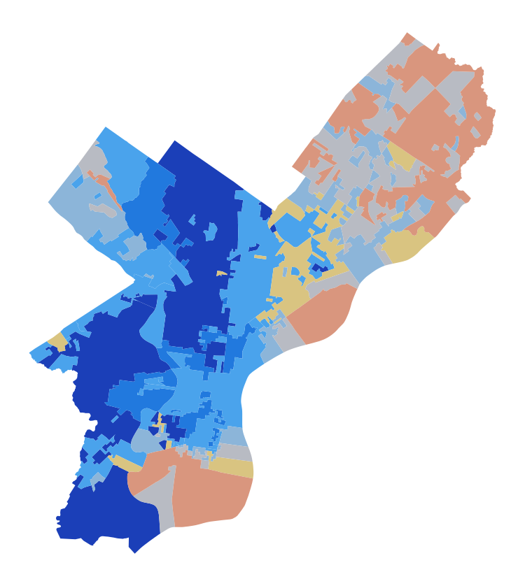
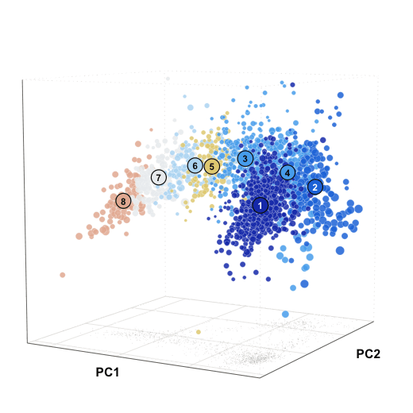

My research is largely on how to use mixture models and hierarchical models to understand complex social dynamics. This is a topic where I think the statistical methods and the data are uniquely converging to provide expansions in how social scientists can conceive of their empirical work. The work that set all of this in motion wasn't social science at all, but microbial genetics. Modeling bacterial genomes as mixtures of related strains turns out to be a remarkable staging ground for thinking about the sorts of variability that occur over and over again in social and cultural systems ([O'Brien et al. 2014](https://doi.org/10.1534/genetics.114.161299)). Like genomes, lots of social science data is highly repetitive, constituted as a mixture of subpopulations, transmissible, and highly structured across time and space. With the advent of AI-enabled data manipulation, we're at a moment where the well-developed statistical architecture of genomic modeling can be repurposed to understand cultural dynamics with new levels of empirical clarity.

::: {.methods-fig}
)](../files/images/lake-chad-pottery.png){fig-alt="Painting-style image of decorated potsherds from the Lake Chad basin." width="60%" fig-align="center"}
:::

Since then, I've been carrying these methods into new kinds of data: decorated potsherds from the Lake Chad Basin ([O'Brien, Lin & MacEachern 2016](https://doi.org/10.1098/rspb.2015.2824)), the daily rhythms of tweets across American cities ([Murthy et al. 2021](https://doi.org/10.1177/0038038520956940)), bumblebee foraging (Max Hukill's honors thesis, Bowdoin 2021), and election returns ([O'Brien 2026](https://doi.org/10.1017/psrm.2025.10050)). These models usually take Dirichlet-multinomial (in the two-outcome case, beta-binomial) components, with different hierarchical structures layered on top to capture the relationships among the components. The analogy I've found most compelling, and have built out furthest, is the one between population genetics and political opinion: precincts are mixtures of voting blocs in the way that genomes are mixtures of ancestral populations ([Pritchard, Stephens & Donnelly 2000](https://doi.org/10.1093/genetics/155.2.945)). That analogy underlies the [PSRM paper](https://doi.org/10.1017/psrm.2025.10050) ([arXiv](https://arxiv.org/abs/2301.01677)) and my current collaboration with [Aaron Kaufman](https://aaronrkaufman.com/) on [local political dynamics](https://github.com/cascobayesian/Local.Politics).

```{=html}
<a class="methods-atlas-link" href="atlas-cities.html" aria-label="Open the city atlas of voting blocs">
  <span class="methods-atlas-pair">
    
    
  </span>
  <span class="methods-atlas-caption">Philadelphia's eight voting blocs, mapped (left) and on the first three principal coordinates of their voting (right). Click to explore the city atlas.</span>
</a>
<style>
.methods-atlas-link { display: block; max-width: 75%; margin: 1.5rem auto; color: inherit; text-decoration: none; border-radius: 6px; padding: .5rem; transition: box-shadow .15s; }
.methods-atlas-link:hover, .methods-atlas-link:focus-visible { box-shadow: 0 0 0 2px #222; }
.methods-atlas-pair { display: flex; gap: 1rem; align-items: center; justify-content: center; }
.methods-atlas-pair img { flex: 1 1 0; min-width: 0; max-width: 50%; height: auto; }
.methods-fig figcaption { text-align: center; }
.methods-atlas-caption { display: block; font-size: .9rem; color: #555; text-align: center; margin-top: .5rem; }
</style>
```

Most of my human clock time is spent fitting MCMC and other numerical approaches to these models. A perennial challenge is estimating *K*, the number of blocs, and here I've been experimenting with the recent explosion of methods: mixtures of finite mixtures ([Miller & Harrison 2018](https://doi.org/10.1080/01621459.2016.1255636)) and their telescoping samplers ([Frühwirth-Schnatter, Malsiner-Walli & Grün 2021](https://doi.org/10.1214/21-BA1294)), Newman's approach using non-empty components ([Newman 2025](https://arxiv.org/abs/2502.19605)), birth-death MCMC ([Stephens 2000](https://doi.org/10.1214/aos/1016120364)), thermodynamic integration and its stepping-stone refinement for the marginal likelihood ([Lartillot & Philippe 2006](https://doi.org/10.1080/10635150500433722); [Xie et al. 2011](https://doi.org/10.1093/sysbio/syq085)), and tempering, both as a sequential Monte Carlo path from prior to posterior ([Del Moral, Doucet & Jasra 2006](https://doi.org/10.1111/j.1467-9868.2006.00553.x)) and as a coarsened posterior that raises the likelihood to a fractional power, which makes the inferred blocs robust to the small departures from the model that real precincts always show ([Miller & Dunson 2019](https://doi.org/10.1080/01621459.2018.1469995)).

For a very non-mathy introduction to voting blocs, check out [these slides](voting_bloc_slides.html).
