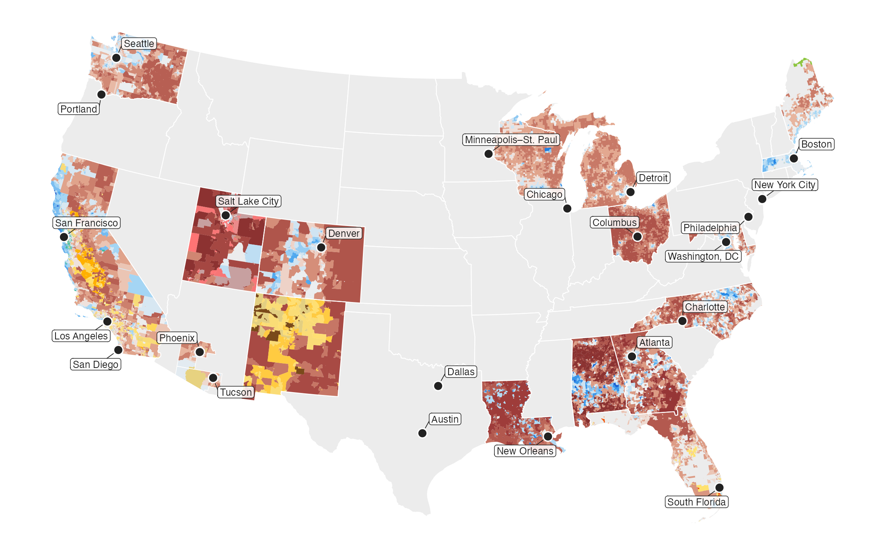

## Abstract

In an increasingly nationalized and increasingly polarized US political landscape, what issues, identities, and ideologies structure *local* politics? Despite growing interest in the politics of local issues like education, housing, land use, and policing, little is known about how these and other issues interact with national partisan identity, or predict voting in local nonpartisan races. We employ a recently developed unsupervised statistical model, applied to an original compilation of precinct-level election results across 38 US states, metropolitan areas, and cities, to study regional and municipal voting patterns. Our model, trained on precinct-level ballot referendum returns, recovers spatial clusters of voting behavior that are independent of national partisan signal, locates the topics and issues that separate those local voters, and identifies the demographic and historical factors that predict cluster membership: race in most places, including all five cities and every southern state, education in New England, Colorado, Utah, and the Pacific Northwest, and the urban–rural divide conspicuously absent. In 22 of the 38 places, national partisanship leaves more than a third of the variation in the median referendum unexplained, and in 34 out of 38 places, some referendums are nearly unrelated to it. In New York City's 2025 Democratic mayoral primary, clusters explain 58 percent of the variation in the winner's vote share across election districts, against 14 percent for national partisanship. And the same coalitions of blocs reappear behind different candidates from one election to the next, revealing durable factions in places without party competition. We provide an open-source, entirely reproducible workflow including software, data sets, and worked examples for understanding local political geography, conflict, and demographic structure. This paper represents the most detailed quantitative description of local political dynamics ever produced.

*Manuscript available upon request.*

## The atlas

::: {.card-grid .two-up}

::: {.pcard}
::: {.pcard-img}
{fig-alt="Map of the United States showing every place fitted with the voting bloc model, colored by bloc." .contain}
:::
::: {.pcard-body}
### [The Atlas of US Voting Blocs](atlas.qmd)

Every place where we have run the voting bloc model: states, metropolitan areas and cities, each mapped by its blocs.
:::
:::

:::
