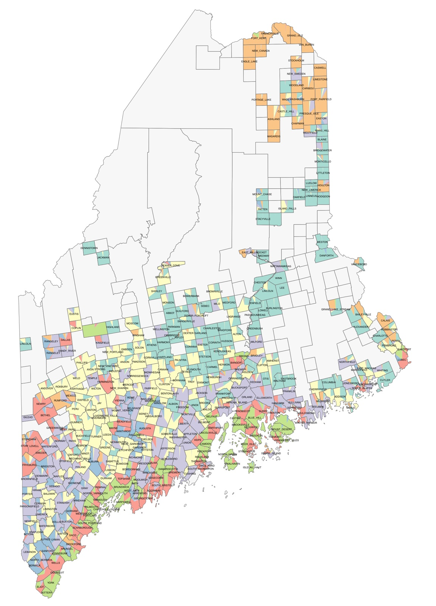

<!-- Outline from Jack's notes. Each section is a placeholder until written. -->

::: {.callout-note appearance="simple"}
This page is being written.
:::

## The analogy to genetics

Population geneticists describe each person's genome as a mixture of ancestral populations. I describe each precinct's votes as a mixture of voting blocs. [Paper (PSRM 2026)](https://www.cambridge.org/core/journals/political-science-research-and-methods/article/bayesian-mixture-model-captures-temporal-and-spatial-structure-of-voting-blocs-within-longitudinal-referendum-data/B2C9A113D969277325F9EDAC4F90E83F) · [arXiv](https://arxiv.org/abs/2301.01677)

{fig-alt="Map of Maine in which each town is divided into colored slices showing its mix of seven communities." width="80%" fig-align="center"}

## What's remarkable

- **Neither left nor right.** The blocs don't line up along a single partisan axis.
- **Spatial.** Nothing in the model knows about geography, yet the blocs come out as contiguous regions.
- **Consistent across elections.** The same blocs recur election after election. Are they political cultures?

## What to do with it

- Statistical innovations: see [Statistical innovations](methods.qmd)
- Political science: see [Local politics](local-politics.qmd)
- Uses of this
