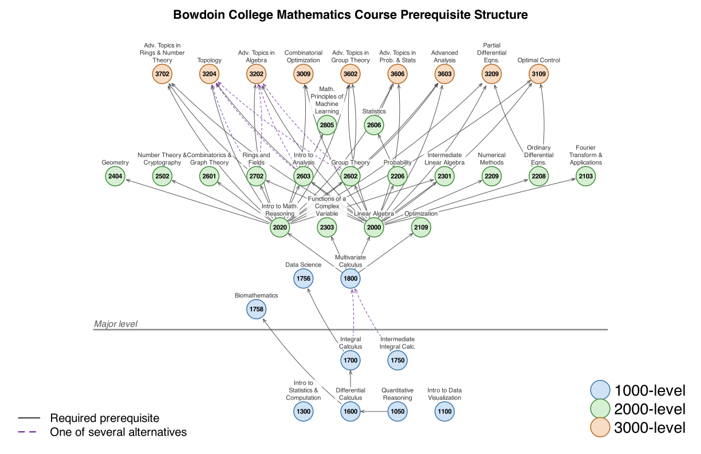

[← Advising](advising.qmd)

Each arrow points from a course to a course that lists it as a prerequisite. Solid arrows are required courses; dashed arrows mark requirements that any one of several courses satisfies. Circles are coloured by level.

{fig-alt="Network diagram of prerequisites among Bowdoin mathematics courses, from the 1000-level calculus and statistics courses at the bottom through the 2000-level courses to the 3000-level advanced topics at the top."}

Source: the [Bowdoin Course Catalogue for Mathematics](https://bowdoin-public.courseleaf.com/departments-programs/mathematics/), retrieved October 19, 2026. The map includes MATH courses offered from Fall 2023 through Fall 2026. MATH 1808 and MATH 3303, last offered before Fall 2023, and the Emerging Scholars workshops (MATH 1610 and 1710) are left out. Placement-exam alternatives and "not open to students with credit for …" exclusions are not drawn. MATH 1756 accepts any course numbered 1700–2969 and MATH 1758 any course numbered 1600–2969; the arrow is drawn from the lowest. MATH 1050 is a prerequisite option for both MATH 1300 and MATH 1600; only the arrow to MATH 1600 is drawn. The catalogue is the authority: check it, and your advisor, before you plan a schedule.
