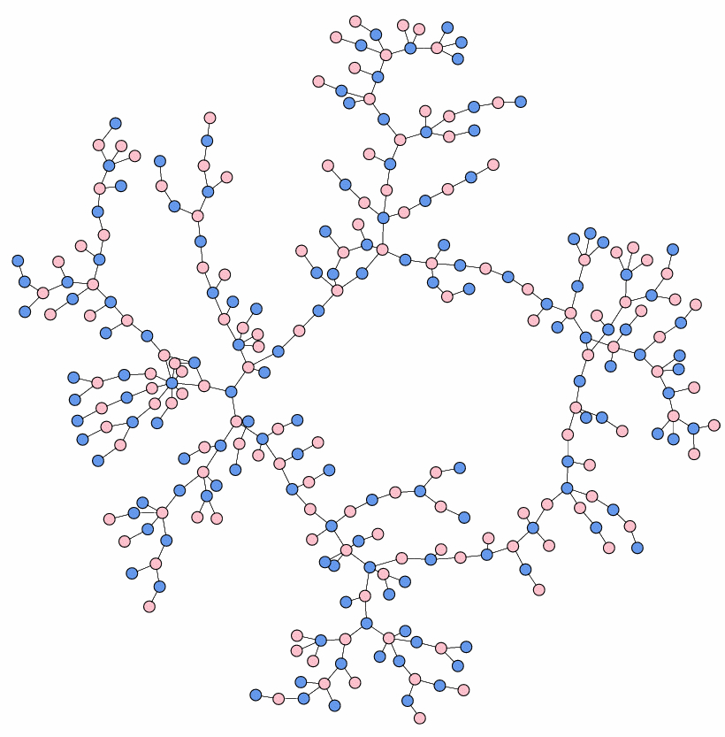
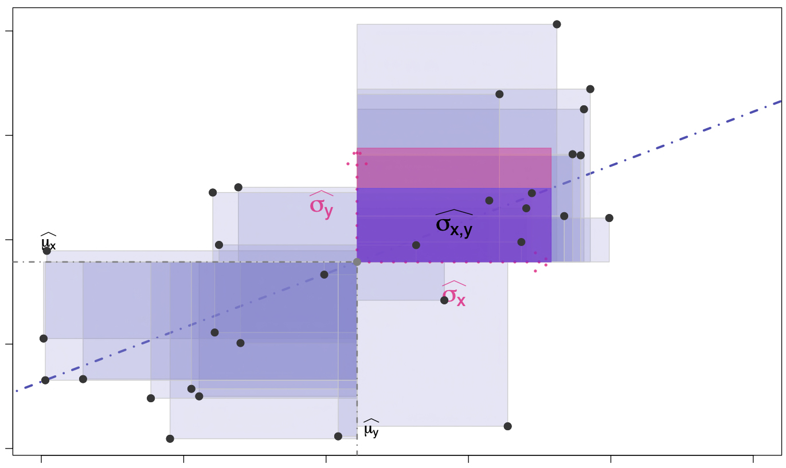
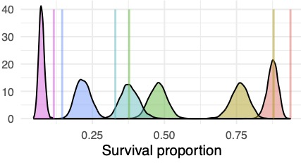

::: {style="text-align: center;"}
> *"In all the works on pedagogy that ever I read ... I don't remember that any one has advocated a system of teaching by practical jokes, mostly cruel. That, however, describes the method of our great teacher, Experience."*
>
> — Charles S. Peirce
:::

## Courses

### Data science (Math 1756)

::: {.grid}

::: {.g-col-12 .g-col-md-4}
{fig-alt="Network diagram"}
:::

::: {.g-col-12 .g-col-md-8}
**Spring 2026**

A calculus-informed, computation-based introduction to data science, taught in R. The course moves from visualizing and describing data to the linear model and its discontents: multiple and categorical regressors, ANOVA, model selection, prediction and omitted-variable bias. Students then do the practical work of logic, cleaning and wrangling data found in the wild, and presenting it in documents and code that people can read. The second half turns to probability and simulation (conditional probability, random variables, data-generating processes, the central limit theorem and the bootstrap) and ends with testing: sensitivity and specificity, p-values, power, effect sizes, and what significance does and does not mean.

Three mini-projects (the visual interpretation of data, data transformations, and writing with uncertainty) build toward a final project in which students present a set of models for a data set of their choosing. The course assumes a semester of calculus; no coding experience is assumed.
:::

:::

### Statistical modelling (Math 2606)

::: {.grid}

::: {.g-col-12 .g-col-md-4}
{fig-alt="Regression plot"}
:::

::: {.g-col-12 .g-col-md-8}
**[Spring 2026](https://cascobayesian.github.io/Computational-Hermeneutics/)** · [Source on GitHub](https://github.com/cascobayesian/Stats2606)

An intensive survey of the practice and principles of statistical modeling. Over the course of the semester, we'll be: (1) learning how to build statistical models; (2) learning how to interpret their results from real data sets, and (3) repeating that in as many ways and contexts as we can possibly squeeze in during our time together. The course is structured as a brisk -- some might say breathy -- tour of many of the workhorses of computational statistics: simulation, parametric models, testing, regression (in its myriad forms), model selection, and clustering. To give students as wide a range of perspectives on the subtle craft, extraordinary power, and varied dangers of statistical reasoning, we'll draw on wide array of examples: municipal hate crimes, speed dating experiments, exoplanet surveys, criminal sentencing, immigration control procedures, and sightings of Big Foot.

Though a comprehensive review is provided, the pace of the material very much assumes a previous course in probability. No coding experience is assumed but for those with truly no experience a lighter schedule for the semester might be wise.
:::

:::

### Bayesian statistics (Math 3606)

::: {.grid}

::: {.g-col-12 .g-col-md-4}
{fig-alt="Plot of a proportion"}
:::

::: {.g-col-12 .g-col-md-8}
**Fall 2025**

An applied course in Bayesian statistics, with intensive use of R. After a review of probability, likelihood and maximum likelihood estimation, the course develops Bayesian reasoning in one-ish dimension: conducting a poll, choosing priors, describing posteriors, and the conjugate models (beta-binomial, Poisson, normal, exponential and normal-gamma), along with numerical approaches and objective priors. The third part covers Markov chain Monte Carlo: rejection and importance sampling, Monte Carlo error, Markov chains, the Metropolis–Hastings algorithm, Gibbs sampling and convergence diagnostics. It closes with complex models: Hamiltonian Monte Carlo in RStan, DAGs, hierarchical models, linear and logistic regression, and ANOVA.

There are no exams. The semester ends with group presentations, in which each group investigates an applied topic in Bayesian methods from the primary literature and presents a worked example. Students need probability, including conditional probability and the common distributions, though the course starts from the beginning to bring everyone to the same level.
:::

:::

## Honors theses

| Student | Year | Thesis | Bowdoin Library copy |
|---|---|---|---|
| **[Nathan Kellerman](#former-research-students)** | 2025–26 | *A Rapid Algorithm for Inferring Latent Mixture Structure in Replicate Social Science Data* | [Digital Collections](https://digitalcollections.bowdoin.edu/view/60900/a-rapid-algorithm-for-inferring-latent-mixture-structure-in-replicate-social-science-data) (Bowdoin login) |
| **[Avery Cutler](#former-research-students)** | 2025–26 | *Beyond the Docket: A Bayesian Exploration of Settlement Outcomes in Boston Evictions* | [Digital Collections](https://digitalcollections.bowdoin.edu/view/60942/beyond-the-docket-a-bayesian-exploration-of-settlement-outcomes-in-boston-evictions) (Bowdoin login) |
| **[Brian Liu](#former-research-students)** | 2024–25 | *Chains for Change: Mathematical Modeling of Boston's Eviction Court Cases* | [Digital Collections](https://digitalcollections.bowdoin.edu/browse/collection/85) (Bowdoin login) |
| **Max Hukill** | 2019–21 | *A Bayesian Hierarchical Mixture Model with Continuous-Time Markov Chains to Capture Bumblebee Foraging Behavior* | [Digital Collections](https://digitalcollections.bowdoin.edu/view/6537/a-bayesian-hierarchical-mixture-model-with-continuous-time-markov-chains-to-capture-bumblebee-foraging-behavior) (open access) |
| **Nan Ding** | 2018–19 | *Rein Control Homeostasis and the Dynamics of Complex Ecosystem Stability* | Special Collections, Thesis 2019 D5 |
| **Jacob Spertus** | 2014–15 | *A Bayesian Exploration of the Arabidopsis thaliana Chloroplast Genome* | Special Collections, Thesis 2015 S647 |
| **Chunyi Zhao** | 2014–15 | *The Card Swiper's Coloring Book: Statistical Inference of Social Cliques from Spatio-temporal Data* | Special Collections, Thesis 2015 Z4 |
| **Zoe Karp** | 2013–14 | *Bayesian Parameter Estimation without Likelihoods: An Example from Lobster Heart Modeling* | Special Collections, Thesis 2014 K3 |
| **Nathan Meyers** | 2012–13 | *The Twitterscape in Time and Space* | Special Collections, Thesis 2013 M4 |

## Former research students (since 2023)

:::{#lab-alumni}
:::
